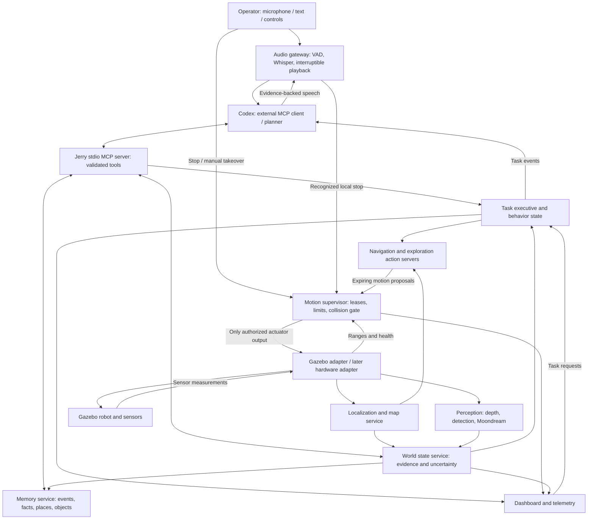
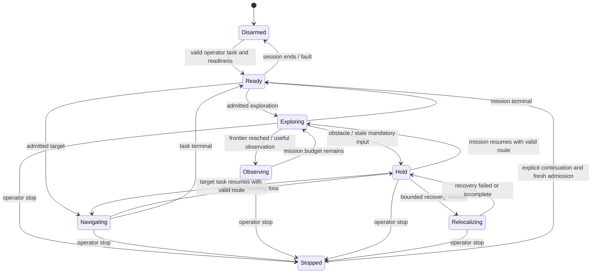

# JERRY: integrated autonomous robot architecture

**Status:** architecture and staged implementation, 7 November 2026. The current integration uses Codex through a local MCP server as the external planner. The `jerry/` runtime and `jerry_interfaces` provide the first simulation integration; capabilities explicitly marked proposed remain delivery targets. The MCP tool list and validated limits are documented in [Jerry MCP setup](docs/JERRY_MCP.md). This is not a claim that every phase or physical-hardware requirement is implemented.

**Immediate objective:** one Gazebo robot that explores from its own sensor estimates, understands spoken requests, answers questions about its surroundings, accepts validated task requests from Codex through MCP, and reports what its actions actually achieved. First prove the system in simulation; then replace the simulator adapter with a measured physical hardware interface.

**Design basis:** the existing AURA dialogue/perception/memory code, the Gazebo Harmonic + ROS 2 Jazzy simulation, the depth/SLAM/exploration implementation, and the [project audit](audit/PROJECT_AUDIT_2026-11-07.md). The [SARAS reference](https://github.com/techwithanant/saras-ai-robot) is inspiration for an embodied conversational robot. At review time that repository contains a hardware-focused README and defers software integration to a follow-up; this design does not assume it supplies a reusable navigation or agent implementation.

### Reading guide

For the next implementation sequence, current reliability gaps and measurable release gates, see the [technical roadmap](docs/JERRY_TECHNICAL_ROADMAP.md). It incorporates the 60-second stalled-goal policy, persistent maps, coordinated recovery, dashboard migration, object approach and emotional expression. Proposed roadmap capabilities remain gated until implemented and validated.

* [System decisions and communication diagram](#2-main-architectural-decisions)
* [Processes, packages, and reuse map](#4-processes-ownership-and-failure-isolation)
* [Messages, actions, time, and transforms](#6-communication-contracts)
* [Motion authority](#8-motion-authority-and-collision-constraints)
* [Codex MCP tools and cancellation](#9-codex-mcp-control-and-tool-execution)
* [Exploration, SLAM, and object grounding](#10-task-executive-and-autonomous-behavior)
* [Speech and resource scheduling](#12-speech-interaction-and-model-resource-scheduling)
* [Audit repairs and delivery phases](#15-audit-repair-plan-and-traceability)
* [Simulation acceptance and physical migration](#17-simulation-validation-matrix)

## 1. Intended behavior and boundaries

The first integrated version should support these interactions:

| User request or event | Expected observable behavior |
|---|---|
| “Jerry, explore the room.” | Begin a bounded exploration mission after readiness checks; select reachable frontiers, track progress, remember observations, and speak occasional useful updates. |
| “What can you see?” | Answer using an identified recent Gazebo camera frame through AURA's VLM; distinguish a current observation from remembered information. |
| “Find the red chair.” | Search reachable viewpoints, detect and verify candidates, and report evidence. Navigate toward a candidate only when its position and approach are sufficiently constrained. |
| “Go near that chair.” | Resolve “that” against the recent grounded conversation; ask which object if ambiguous; plan to a collision-checked stand-off location. |
| “Stop.” / Stop button | Stop through the deterministic interrupt path, cancel the active motion task, and prevent old work from restarting it. |
| “Continue exploring.” | Start or resume the explicitly requested mission after fresh readiness checks; no automatic restart from an old model reply. |
| “What did you find earlier?” | Query persistent episodes and object observations, including their time and uncertainty. |
| Someone or an object blocks the route | Brake, wait/replan within limits, and explain persistent failure. A dialogue answer must not claim arrival without task evidence. |
| Codex/network unavailable | Keep local stopping and already authorized bounded navigation operational; use deterministic local commands and explain unavailable reasoning. |

“Own brain” means a persistent, integrated perception–memory–planning–action system running under the robot's control software. It does not imply consciousness, an LLM inventing sensor measurements, or self-modifying navigation code. Learning in the first releases means updating maps, places, object associations, episodes, and explicit preferences. Model fine-tuning and unrestricted code generation are outside the initial runtime.

The simulation profile uses the robot's camera, four ultrasonic ranges, raw IMU, and compass. It does not consume simulator ground-truth pose, perfect depth, a complete scene map, or wheel joints as navigation odometry. A separate evaluator may use ground truth to measure performance. The simulator currently supplies no speech environment: during interactive simulation, the operator's laptop microphone and speaker provide the audio interface.

## 2. Main architectural decisions

1. Use ROS 2 as the robotics transport. Keep cognition and algorithms in importable Python packages with typed contracts; use explicit local IPC for model workers that need a separate interpreter.
2. Give one task executive ownership of user missions and autonomous subgoals. Conversation and exploration may run together, but only one motion task owns a motion lease.
3. Use Codex as the external planner through MCP. It requests implemented semantic tools such as bounded exploration, current camera evidence, task status, memory and Stop. Grounded `find_object` and `navigate_to` remain gated capabilities until their geometry contracts are implemented. Deterministic task code owns paths/controllers; Codex never publishes wheel duties or velocity commands.
4. Put command arbitration, freshness checks, collision constraints, stop latches, and command expiry in a separate motion supervisor process. The GUI, cloud client, and model workers cannot be required for stopping.
5. Reuse AURA's speech engines, optional VLM, grounding ideas and memory components. Replace its provider-based single-turn planner with external Codex MCP calls and a deterministic task executive.
6. Reuse the constrained floor/compass SLAM and frontier algorithms as the first measured baseline. Expose their limitations and confidence explicitly. Do not claim general visual-inertial SLAM by renaming them.
7. Version time epochs, map corrections, calibration, goals, observations, and requests. Reject stale output at the receiving authority, not only in a prompt.
8. Retain local Whisper, optional Moondream, Kokoro and existing depth inference. The integrated runtime makes no separate LLM/provider calls: Codex receives MCP image/tool results and performs high-level reasoning. Existing AURA provider adapters remain standalone components outside this runtime.
9. Use the same core contracts in simulation and hardware. Capability differences must disable unsupported behaviors instead of fabricating data.
10. Run the deterministic mission executive independently of dialogue and inference. Cognition failure may leave an admitted bounded mission running; executive failure revokes motion through lease expiry.
11. Preserve command expiry across transport hops, establish a motion barrier before map corrections, and distinguish coordinate changes from ordinary occupancy updates.

## 3. System communication diagram



Raw sensor streams feed perception and the safety path directly. Semantic observations feed the world state. The executive subscribes to compact events rather than polling every camera frame through the LLM. The final actuator adapter accepts output only from the motion supervisor's live session.

## 4. Processes, ownership, and failure isolation

These are logical processes for the initial laptop deployment, not a requirement to deploy microservices across machines. A ROS node is not automatically a separate process; the launch file must enforce the isolation below.

| Process | Owns | Failure behavior |
|---|---|---|
| `jerry_bringup` | Configuration, process lifecycle, session creation, readiness aggregation | Its loss must not prevent adapter command expiry. Restart begins disarmed. |
| `jerry_gazebo_adapter` | Gazebo sensor conversion, actuator transport, final watchdog | Missing supervisor heartbeat/session produces zero actuator commands. |
| `jerry_motion_supervisor` | Stop latch, motion lease, command validity, final motion gate | Adapter watchdog stops robot if this process fails. |
| `jerry_localization` | Attitude, local odometry, global corrections, occupancy submaps | Translation stops when pose quality or required sensor freshness is insufficient. |
| `jerry_navigation` | Path planning, following, frontier selection, bounded recovery | Lease and proposals expire on failure. |
| `jerry_perception` | Camera frame references, detections, neural depth metadata, observation requests | Mandatory local cues becoming stale stop affected motion modes; semantic VLM failure alone need not stop ordinary exploration. |
| `jerry_model_broker` + child workers | Model admission, device budgets, inference lifecycle | Failed/late inference is discarded. Restart does not restore an old task's authority. |
| `jerry_executive` | Deterministic task state, admission, mission budgets, preemption, motion lease renewal | Failure stops motion through lease expiry; restart reconciles durable state while disarmed and requires a new operator continuation. |
| `jerry_cognition` | Local speech/vision interaction, bounded Whisper/Kokoro/Moondream worker requests; no LLM planner | Executive may continue admitted bounded work. Direct operator Stop/status remain available. |
| `jerry_robot` MCP server | Stdio MCP tools, ROS client, current camera evidence, Codex request validation | Disconnect requests Stop/cancellation; an owned simulation shuts down. Independent leases/watchdogs remain the fallback. |
| `jerry_memory` | Sole SQLite writer, task journal/outbox, retrieval, index jobs, map/object references | Reject new durable missions/writes. An admitted mission may continue under the executive's bounded storage-outage policy; pending terminal results are reconciled on recovery. |
| `jerry_dashboard` | Rendering, operator controls, diagnostic views | It is a client; closing it is not required for the navigation loop to stay responsive. Session policy decides whether its departure also requests disarm. |
| `jerry_evaluator` | Ground-truth metrics, collision observation, test scoring | Test-only process; none of its measurements enter navigation or cognition. |

ROS callbacks enqueue bounded work and return. They do not run model inference, network calls, map replay, SQLite migrations, or GUI operations. Control and adapter processes do not import Torch, model SDKs, or Qt. Their loops run on monotonic wall time; this is a best-effort Python/ROS system, not a hard real-time guarantee.

### 4.1 Packaging and interpreter boundaries

The repository currently has unrelated packages named `src` in its root, AURA, depth app, and VQA app. Importing all of these into one interpreter is unreliable. The new software must remove that ambiguity rather than extend the dynamic `vbmd_depth_backend` module workaround.

Proposed layout:

```text
Architecture.md
pyproject.toml                     # workspace developer tooling and dependency groups
packages/
  jerry_core/                     # typed domain models, pure algorithms, policies
    pyproject.toml
    src/jerry_core/
      contracts/  tasks/  navigation/  safety/  world/
  jerry_cognition/                # migrated AURA components, no generic src imports
    pyproject.toml
    src/jerry_cognition/
      speech/  llm/  vlm/  memory/  dialogue/  tools/
  jerry_models/                   # worker entrypoints and model broker client
    pyproject.toml
    src/jerry_models/
simulation/ros2_ws/src/
  vbmd_description/              # retain robot meshes, worlds, URDF and generators
  jerry_interfaces/              # generated ROS messages, services, actions
  jerry_ros/                     # nodes adapting the pure packages to ROS
  jerry_bringup/                 # launch files and complete deployment profiles
config/jerry/
  common.yaml  sim.yaml  hardware.yaml  models.yaml
tests/jerry/
  unit/  contracts/  integration/  simulation/  audio/  endurance/
```

Install packages into the ROS-compatible interpreter and the model environment as needed. Keep heavyweight CUDA dependencies in the model environment. Model workers communicate through a versioned local Unix socket protocol plus bounded shared-memory frame slots; ROS-facing code stays in the interpreter compatible with the installed Jazzy `rclpy`. Use explicit serialization, never arbitrary pickle from a network endpoint. Worker subprocess arguments contain no API keys; secrets come from the process environment or local secret configuration.

For the first migration checkpoint, AURA may run in its own process with a ROS-backed camera adapter. Its imports remain isolated until moved to `jerry_cognition`. That bridge must not open a second camera or run a second navigation controller.

## 5. Reuse and replacement map

| Existing component | Integration decision | Required change |
|---|---|---|
| `AURA/src/speech/{audio_capture,vad,whisper_engine}.py` | Reuse ASR and capture behavior | Introduce typed utterance events and request cancellation; allow recorded audio fixtures. |
| `AURA/src/speech/{kokoro_engine,segmentation}.py` | Reuse TTS and chunking | Speak short chunks with request generation IDs; cancel active output, not only queued chunks. |
| `AURA/src/speech/audio_player.py` | Replace playback lifecycle around existing TTS output | Abortable output stream; tracked subprocess termination for fallback players. Current whole-buffer blocking playback cannot provide reliable barge-in. |
| `AURA/src/intelligence/llm/*` and `groq_client.py` | Keep standalone diagnostics only | Not imported or called by the integrated planner; Codex uses the MCP server. |
| `AURA/src/perception/{moondream_engine,vlm/*}.py` | Reuse VLM implementations | Consume selected ROS frame snapshots, preserve source timestamp, cancel/discard late results. |
| `AURA/src/intelligence/{prompt_builder,response_generator}.py` | Reuse grounding and response composition ideas | Include actual task states, evidence IDs, and uncertainty; separate accepted task from completed task. |
| `AURA/src/orchestrator/{agent,scheduler,tool_registry}.py` | Refactor orchestration | Asynchronous multi-step tool loop, task IDs, guarded side effects, cancellation through all stages. |
| `AURA/src/memory/*` | Reuse storage, retrieval, event and consent models | Add map/object anchors and task events; one writer authority; repair scheduler shutdown. |
| `realtime_depth_app/src/robot_slam.py` | Extract baseline localization, occupancy, planner | Split local odometry/global corrections; map revisions; bounded submaps/history; cancelable task interfaces. |
| `robot_avoidance.py`, `robot_motion.py` | Reuse pure policies after fixes | Typed motion constraints; safety gate after smoothing; identical constraints in all control modes. |
| `depth_engine.py`, `robot_depth_worker.py` | Reuse inference and process isolation | Correct dtype, robust frame-reference lifetime, deadlines and health reporting. |
| `robot_detection.py` | Reuse detector and decoding | Publish versioned image observations; add tracking/association separately. |
| `realtime_depth_app/robot_live.py` | Decompose | Move sensor ingestion, control, map publication, and task logic into their owning nodes. |
| `robot_window.py`, AURA GUI panels | Reuse useful views | One dashboard consumes both robotics and dialogue events; remove controller ownership from UI. |
| Gazebo adapter and launch files | Retain transport integration | Remove independent autonomous command authority; add supervisor session enforcement and runtime world name. |
| `src/robot/driver.py` | Keep as legacy manual diagnostic | Exclude LLM-to-duration direct driving from integrated runtime. Later hardware adapter replaces this command path. |
| `moondream-live-vqa` | Keep standalone diagnostic | Fix freshness; integrated VLM comes from AURA to avoid a second assistant stack. |

## 6. Communication contracts

### 6.1 Transport choices

Use topics for observations and current state, actions for long-running work with feedback/cancellation, and services for short operations with a known completion boundary. ROS actions provide goal, feedback, and result communication; cancellation must still be implemented by the server. See the [official Jazzy action tutorial](https://raw.githubusercontent.com/ros2/ros2_documentation/jazzy/source/Tutorials/Intermediate/Writing-an-Action-Server-Client/Py.rst).

Do not encode operational contracts as free-form JSON inside `std_msgs/String`. That can remain a diagnostic compatibility output while new consumers use `jerry_interfaces` types. In-process equivalents use Pydantic models with forbidden extra fields, bounded collections/strings, finite-value validators, and explicit enum versions.

### 6.2 Common identity and time fields

All proposed application envelopes carry:

```text
schema_version: uint16
robot_id: string
session_id: UUID                  # changes when the runtime/adapter session restarts
epoch_id: uint64                  # changes on simulation reset or time discontinuity
event_id: UUID
request_id: UUID or empty         # conversation turn or operator request
task_id: UUID or empty
sequence: uint64                  # monotonic within producer/session/epoch
source_stamp: ROS Time            # acquisition or event time in its declared clock
clock_domain: SIM | SYSTEM
```

The receiver records its own local monotonic receipt time. Do not transmit a monotonic timestamp between hosts and assume their origins match. Frame references also carry `camera_id`, acquisition sequence, ROS `frame_id`, image geometry, and `calibration_revision`. An immutable observation is identified by all relevant IDs, not a process-local integer alone.

`map_id` identifies a persistent map. `map_revision` identifies its coordinate geometry and anchor solution; it changes on loop correction, rebase, or a change that alters existing coordinate meaning. `occupancy_revision` identifies ordinary cell/evidence updates within that geometry. Atomic map snapshots carry both. Routine occupancy updates require route-clearance validation but do not invalidate every spatial anchor. `calibration_revision` identifies intrinsics/extrinsics. A runtime restart does not silently make old map-relative locations valid in a new map.

### 6.3 Proposed ROS interface inventory

Names below are relative to `/<robot_id>`; deployment remaps current global sensor topics into that namespace. `/clock` remains the simulation clock.

| Interface | Type | Owner → consumers | Delivery / meaning |
|---|---|---|---|
| `sensors/camera/image_raw` | `sensor_msgs/Image` | adapter → frame service, localization | Best effort, volatile, keep last 1. Preserve capture stamp. |
| `sensors/camera/camera_info` | `sensor_msgs/CameraInfo` | adapter → geometry consumers | Matched reliable/transient-local endpoints, depth 1, calibration revision separately. |
| `sensors/range/{front,left,rear,right}` | `sensor_msgs/Range` | adapter → safety, mapping | Sensor QoS; local latest cache per sensor. |
| `sensors/imu` / `sensors/magnetic_field` | `sensor_msgs/Imu`, `MagneticField` | adapter → localization | Best effort, bounded histories for timestamp alignment. |
| `localization/odometry` | `nav_msgs/Odometry` | localization → navigation | Measured local VO/IMU estimate with covariance, never commanded-motion integration. |
| `localization/status` | `LocalizationStatus` | localization → executive, safety | Tracking quality, uncertainty validity, stamp, map revision. |
| `map` / `map/status` | `OccupancyGrid`, `MapStatus` | map service → standard viewers, diagnostics | Compatibility output; transient-local depth 1 for map. |
| `mapping/snapshot` | `MapSnapshot` | map service → planner, world state | Authoritative atomic grid + map/revision/epoch metadata; compatibility `map` output is for standard viewers. |
| `perception/depth_relative` | `Image` + `DepthMetadata` | perception → standard viewers, diagnostics | Latest only; units and source frame identity explicit. |
| `perception/depth_observation` | `DepthObservation` | perception → safety | Authoritative image + source reference + units in one envelope; split compatibility outputs cannot be joined by arrival order. |
| `perception/objects` | `ObjectObservationArray` | perception → world state | Detections/bearings, optional measured locations, source evidence. |
| `world/snapshot` | `WorldStateSummary` | world state → cognition, UI | Bounded, versioned semantic view; not a raw image feed. |
| `tasks/events` | `TaskEvent` | executive → speech, memory, UI | Reliable, bounded queue; sequence gaps trigger query of authoritative task state. |
| `motion/proposal` | `MotionProposal` | active navigation/manual client → supervisor | Latest, volatile, depth 1; lease, sequence, expiry and constraints required. |
| `motion/state` | `MotionState` | supervisor → adapter, UI, executive | Active owner, stop reason, actual authorized command and health. |
| `actuation/command` | `ActuatorCommand` | supervisor → adapter | Leased/session-scoped, expiring, finite, bounded command. Sole integrated actuator input. |
| `audio/transcript` | `TranscriptEvent` | audio gateway → executive/agent | Reliable bounded final transcripts; partial text never starts movement. |
| `audio/status` | `AudioStatus` | audio gateway → UI/agent | Capture, decoding, synthesis, playback and interruption state. |
| `health` | `ComponentHealth` | all → bringup/supervisor | Heartbeats plus semantic readiness; heartbeat alone does not prove valid data. |
| `navigation/navigate` | `Navigate.action` | executive → navigation | Goal, feedback, cancel, terminal result. |
| `navigation/explore` | `Explore.action` | executive → exploration | Bounded mission with frontier subgoals and progress. |
| `perception/observe` | `Observe.action` | tool gateway → perception | Exact selected frame, question, freshness/deadline. |
| `speech/speak` | `Speak.action` | agent → audio gateway | Chunked utterance, generation ID, cancelable playback. |
| `tasks/get`, `tasks/cancel` | typed services | clients → executive | Status reconciliation and idempotent cancellation. |
| `motion/stop` | `StopMotion.srv` | operator/interrupt path → supervisor | Immediate latch request and acknowledgement; independent of LLM. |
| `motion/lease` | typed lease services | executive/manual → supervisor | Atomic acquire/renew/revoke with ownership generation. |
| `motion/freshness`, `actuation/freshness` | typed token services | navigation → supervisor; supervisor → adapter | Receiver-issued bounded validity, owner/generation/revision binding; request/response IDs prevent admitting obsolete renewals. |
| `motion/correction_barrier` | typed action | executive → supervisor | Revoke old geometry, await adapter generation/zero acknowledgement, expose barrier ID and failure; release only after matching revised route/readiness. |
| `actuation/status` | `ActuationStatus` | adapter → supervisor, executive | Accepted generation/sequence, zero authorization, watchdog state and measured motion validity; distinguishes zero command from physical stopping. |
| `sim/control` | adapter service | operator → Gazebo world control | Pause/reset/resume derive world name from launch config. |

QoS policies are proposed deployment choices. ROS endpoints must have compatible profiles; history, reliability, durability, and lifespan have different roles. Application freshness checks remain mandatory even when middleware deadlines/lifespans are configured. See [official Jazzy QoS documentation](https://raw.githubusercontent.com/ros2/ros2_documentation/jazzy/source/Concepts/Intermediate/About-Quality-of-Service-Settings.rst).

Consumers making control decisions use the atomic `MapSnapshot` and `DepthObservation` wrappers. Standard image/grid topics remain available for RViz and compatibility, but consumers never infer matching revisions from the order in which separate topics arrive. Large internal snapshots may use immutable shared-memory references with an equivalent lifetime/revision contract.

### 6.4 Key domain models

```text
MotionProposal
  envelope, lease_id, lease_generation, controller_id, sequence
  linear_m_s, angular_rad_s
  freshness_authorization         # receiver-issued token with receiver-clock expiry
  validity_ms                     # additional capped hold limit; cannot extend token expiry
  source_sensor_stamp, epoch_id
  map_id, map_revision, occupancy_revision, path_revision
  mode: TRACK | PIVOT | REVERSE | HOLD
  constraint: stationary_translation_required, speed_cap, recovery_id?

NavigationGoal
  task_id, goal_id, parent_task_id, idempotency_key
  target: PlaceAnchor | ObjectAnchor | ExplicitMapPose
  map_id, map_revision, tolerance_m, stand_off_m
  maximum_active_sim_s, maximum_wall_s, recovery_budget
  requested_by, originating_request_id

ObjectObservation
  observation_id, source_frame_ref, capture_pose_ref
  detector_label, detector_score, bbox_xyxy, track_id?
  attributes[], vlm_evidence_id?, association_state
  bearing_rad?, metric_position?, covariance?, geometry_source
  anchor_keyframe_id?, anchor_local_position?, map_revision
  observed_at, last_verified_at, stale_after_s

TaskResult
  task_id, status, reason_code, evidence_ids[], final_pose_ref?
  side_effect_state: NONE | COMMITTED | UNKNOWN
  completed_subgoals, started_at, ended_at
```

Missing covariance is `uncertainty_valid=false`, not an all-zero matrix suggesting certainty. Relative depth carries `RELATIVE_INVERSE` and arbitrary units; no consumer may treat it as a metric depth-camera stream.

### 6.5 Example action definition and progress semantics

Proposed `Navigate.action`, using generated supporting message types:

```text
# Goal
jerry_interfaces/TaskContext context
jerry_interfaces/TargetAnchor target
float32 positional_tolerance_m
float32 stand_off_m
builtin_interfaces/Duration maximum_active_duration
builtin_interfaces/Duration maximum_wall_duration
uint16 maximum_recovery_attempts
---
# Result
jerry_interfaces/TaskResult outcome
geometry_msgs/PoseWithCovarianceStamped final_pose
bool final_pose_valid
---
# Feedback
string task_id
uint64 feedback_sequence
uint64 map_revision
string phase
float32 remaining_distance_m
bool remaining_distance_valid
uint16 recovery_attempts
string blocking_reason
```

`TargetAnchor` is a validated tagged union: exactly one place ID, object ID, or explicit map pose is selected, with map identity/revision and supporting evidence. Durations are finite positive values bounded by session policy. Feedback arrives at up to 5 Hz and on phase changes. Action acceptance confirms admission, not arrival. Arrival requires measured pose tolerance and debounce; the terminal result includes that evidence. Cancellations revoke the motion lease immediately while the action server completes its terminal bookkeeping. `Explore.action` adds region and coverage/travel budgets and reports frontier subgoal IDs under one parent mission.

## 7. Clocks, freshness, frames, and reset handling

Use three clocks for distinct purposes:

* **ROS simulation time:** sensor alignment, robot motion duration, trajectory evaluation, map updates.
* **Local monotonic time:** control watchdogs, subprocess/network deadlines, audio playback, task wall budget, command leases.
* **UTC/system time:** persisted human-readable history and cross-session retrieval; never use adjustable wall time for watchdog expiry.

A paused simulation freezes robot task progress but not inference/network deadlines or command expiry. Pause revokes motion and requires an explicit continuation after fresh data return. A world reset increments `epoch_id`, revokes all leases, cancels live navigation, clears sensor association buffers, invalidates pending inference/optimizer jobs from the old epoch, and creates a new map unless a separate validated relocalization flow explicitly selects an existing map. Keep conversation history but mark old spatial facts as belonging to the prior map.

Every live sensor consumer checks both acquisition age in the correct clock domain and monotonic receipt age. Future stamps beyond tolerance are rejected, not clamped to “fresh.” The adapter must stop if `/clock` stops advancing even if duplicate clock messages arrive.

Initial simulated freshness limits, inherited where sensible from the current implementation, are tunable starting values:

| Data | Maximum age / condition |
|---|---|
| Camera for local navigation | Receipt age 0.65 s; valid stamp in current epoch |
| Mandatory neural depth in baseline mode | Acquisition and receipt age 0.45 s |
| Each ultrasonic | Receipt age 0.8 s; source age 0.65 s; no NaN; range semantics validated |
| Pose for translation | Source age 0.30 s; tracking quality accepted; uncertainty below mode limits |
| IMU / compass | Start with current 0.35 s / 0.60 s source limits; reject invalid calibration |
| Live VLM question | Frame selected within 1.0 s of request; explicitly report capture time |
| Semantic navigation target | Require fresh geometric verification before final approach; initial recheck at least every 2 s while approaching |

A VLM may take longer than the frame-selection age. Its answer remains evidence about the captured frame, not proof of the robot's current surroundings. Re-observe before any subsequent action requiring current geometry.

### 7.1 Transform tree

Target transform tree:

```text
map -> odom -> base_footprint -> base_link -> camera_link -> camera_optical_frame
                                        -> ultrasonic sensor frames
                                        -> imu_link / magnetometer_link
```

`odom -> base_footprint` is the continuous locally measured estimate. `map -> odom` carries global loop corrections. One publisher owns each edge. Robot state publisher owns fixed/joint geometry, not global localization. The map frame may jump on correction; local odometry should stay continuous. These semantics follow [REP-105](https://raw.githubusercontent.com/ros-infrastructure/rep/master/rep-0105.rst).

The current code publishes `map -> base_footprint` directly. Splitting this requires preserving the pre-correction measured motion stream and computing global correction separately. Publishing an identity `map -> odom` beside a jumping pose does not satisfy the new contract. If tracking fails, report invalid local odometry; do not invent it from motor commands. Start in the existing direct-map compatibility mode until this split passes tests; only one mode may publish transforms at a time.

Transform observations at **capture time** using a bounded timestamped pose buffer. Reject unavailable transforms and calibration mismatches. Do not combine an older image with the latest pose simply because both are available.

## 8. Motion authority and collision constraints

### 8.1 Authority ordering

Priority is: latched stop or invalid mandatory input; operator manual takeover; explicit user motion task; autonomous exploration/recovery; idle. No lower-priority activity resumes automatically after a higher-priority task ends unless the executive's mission policy explicitly permits it and checks freshness again.

The supervisor owns an atomic lease record: `(session, epoch, owner, lease_id, generation, expiry)`. Renew at 10 Hz with an initial 0.30 s lease TTL. Proposals run at 20 Hz and have at most 0.15 s of authorization from issuance, including transport delay. The final adapter watchdog expires authorized output within 0.30 s wall time. These are initial **command authorization** targets; measured physical stopping time includes actuator and mechanical response.

The implemented single-laptop profile uses a receiver token **and** a per-command shared `CLOCK_MONOTONIC` deadline at the adapter hop. The supervisor forwards the earliest upstream proposal/lease expiry as `not_after_monotonic_s`; the adapter requires `clock_id` to match the Linux boot UUID and takes the minimum of that deadline, its receiver token expiry and its own lease expiry. This profile is limited to processes on the same Linux boot. It removes needless control gaps caused by independently phased token windows without extending upstream validity. A different-host/MCU clock identity is rejected; physical migration must implement a validated receiver-token budget or bounded clock-offset protocol before enabling motion. The token-only handoff below remains the alternative cross-clock design, not an assumption that all monotonic origins match.

Every motion hop rejects delayed, previously unseen commands as well as replays. The initial protocol uses receiver-issued freshness tokens bound to session, epoch, owner, lease generation and map revision. The receiver stores each token's non-extendable expiry in its own monotonic clock. Navigation obtains tokens from the supervisor; the supervisor obtains tokens from the adapter. Tokens may cover a bounded stream of increasing command sequences, but heartbeat traffic and command receipt never extend their expiry. Renewal issues a new token and late renewal responses cannot revive old authority. An adapter token's authorization window must fit within the upstream lease's remaining budget after conservative round-trip timing allowance; reject admission when insufficient budget remains. A validated shared-clock deadline protocol is an alternative deployment, with explicit offset/error bounds and restart handling.

For each command, effective expiry is the earliest of token expiry, lease expiry and the capped command hold deadline. Forwarding never restarts the original validity budget. Stopping on lost token/renewal traffic is expected. Configure middleware lifespan as an additional defense; application validation remains authoritative. Test arbitrary queue delays and delayed first delivery independently at both hops.

Only the current lease can submit motion. Old generations, duplicate or decreasing sequences, wrong epochs, non-finite values, and expired data are rejected. Stop increments the generation and revokes the lease before acknowledging the local latch. It propagates revocation to the adapter, which invalidates old tokens and rejects old-generation commands even if they arrive after zero output. Report local latch acceptance, adapter acknowledgement and physical stopping separately; lost revocation traffic leaves the independent adapter expiry as the fallback bound. A delayed LLM result, action feedback, or velocity proposal cannot restore authority. Startup ROS node-name discovery remains a convenience, not exclusivity enforcement.

Legacy `/cmd_vel`, keyboard events, and manual UDP driving must be remapped into proposal clients or disabled in the integrated launch. The Gazebo actuator bridge receives only the adapter's output. Local ROS deployment assumes trusted operator processes; enforce publisher/access restrictions with deployment isolation and DDS permissions before exposing it to other machines. Namespace naming alone is not an access-control boundary.

### 8.2 Final command pipeline

```text
task controller proposal
  -> lease / epoch / deadline validation
  -> permitted mode and speed limits
  -> acceleration and yaw smoothing
  -> stationary-translation constraint
  -> swept-footprint and sensor collision gate
  -> final finite-value / stop-latch check
  -> expiring actuator command
  -> adapter watchdog
```

The safety gate follows smoothing so smoothing cannot reintroduce translation into a pivot, delay an emergency zero, or retain an unsafe reverse command. `PIVOT` and `HOLD` carry explicit kinematic constraints instead of relying on a growing list of string states. Safety zero bypasses smoothing. A recovery planner must request a reverse mode; it does not bypass the gate.

Calculate clearance using the calibrated footprint, sensor origins, uncertainty, latency, and braking behavior. A starting forward clearance requirement is:

```text
required_clearance = footprint_projection + static_margin + uncertainty_margin
                   + |v| * total_observation_and_command_latency
                   + v² / (2 * minimum_measured_braking_deceleration)
```

All terms use one documented reference frame; subtract sensor-to-footprint offsets when comparing sensor ranges. For turning, validate the whole swept footprint and angular stopping behavior, including front/rear corners. Do not reuse the forward formula as the entire pivot test. Unknown map cells do not count as known safe traversal space.

Start with 0.065 m/s exploration travel, 0.08 m/s absolute autonomous forward cap, 0.035 m/s bounded reverse, and 0.4 rad/s autonomous yaw cap, subject to the stricter gate. Existing simulator thresholds are initial calibration inputs, not proof of hardware clearance. Positive infinity means no echo to the sensor limit, negative infinity means too close, and NaN means invalid. No echo is not proof against glass, thin objects, or hazards outside the beam.

The baseline lab profile requires fresh camera/depth/ranges/pose for travel. Future modes may reduce mandatory sensors only through an explicitly tested capability profile. A missing optional VLM does not silently relax navigation requirements. Stairs, drop-offs, and general outdoor terrain are outside the first flat-floor profile; later deployment needs suitable sensing.

### 8.3 Observed free space and dynamic obstacles

Each capability profile defines a measured inverse sensor model: beam coverage, mounting geometry, range limits, uncertainty, invalid/no-echo handling, and the cells that a reading may clear or mark occupied. The existing mapper's cone clearing assumes Gazebo reports the minimum over sampled rays. That is a simulation-specific observation model, not a guarantee supplied by a physical ultrasonic sensor. A hardware profile must validate its own model before enabling equivalent clearing. Never clear outside demonstrated sensing coverage or beyond an ambiguous return.

Keep a persistent occupancy layer and a bounded, freshness-aware local obstacle layer. New credible obstacles block immediately; removal requires fresh clearing evidence, not merely a timeout. Expired local free-space evidence becomes unknown for the affected motion horizon. Local obstacles veto the route even before the persistent map incorporates them. Relative depth supplies a separately validated qualitative hazard veto; it cannot clear metric cells or set metric stopping distances without validated scale. VLM output never clears obstacles.

At startup, mark only the actually occupied footprint as free and accumulate stationary observations. Admit travel only after the swept footprint and stopping horizon lie in sufficiently supported free space. Admit a scan pivot only when its full swept footprint is supported. If neither travel nor pivot can be established safely, report `INSUFFICIENT_OBSERVED_FREE_SPACE`; do not bootstrap by driving into unknown cells. Test both successful empty-map startup in the supported lab and explicit refusal in tightly enclosed or inadequately sensed starts.

Freshness thresholds, command windows and speed caps form one latency budget. Validate acquisition, transport, inference, scheduling, supervision, adapter and braking delays together under load. A locally fresh receipt does not compensate for an old acquisition. Report stop-latency tails and maximum observed delay alongside p95; any command surviving its authorization bound fails the trial.

## 9. Codex MCP control and tool execution

### 9.1 Codex plans through MCP

Codex is the external high-level planner. `simulation/run_robot_mcp.sh` starts a local stdio MCP server; Codex connects using the configuration in `config/jerry/codex-mcp.toml`. No OpenAI/Groq API key or separate cloud LLM client is required by the robot server. Codex itself uses the user's configured Codex account/model. Its conversational response time is outside the control loop and is never a stopping dependency.

```text
operator request in Codex
  -> MCP tool request with bounded validated arguments
  -> fresh session/generation/capability check
  -> deterministic executive admission and durable journal
  -> navigation proposals through supervisor and adapter watchdog
  -> accepted task ID, then measured status/result/evidence
  -> Codex can inspect the camera/map, recall memory and request local speech
```

The MCP server starts independently of Gazebo. `start_simulation` explicitly launches an owned, disarmed runtime; `robot_status` reports actual readiness rather than treating process launch as readiness. The current simulation defaults to ROS domain 87 and Gazebo partition `jerry_integrated` to separate it from the legacy domain-86 dashboard. Overrides must match on the MCP and simulator sides.

Current tools: `start_simulation`, `robot_status`, `robot_camera`, `robot_map`, `start_exploration`, `stop_robot`, `get_task_status`, `wait_for_task`, `query_memory`, `remember_fact`, `remember_observation`, `speak`, and `listen_once`. They use generated typed ROS contracts. Camera/map tools return MCP image blocks with acquisition/provenance metadata so Codex can inspect actual robot observations directly. The MCP surface exposes no shell, raw velocity, motor duty, arbitrary ROS publishing, world editing or ground-truth pose.

`listen_once` captures one bounded host-microphone utterance and returns its Whisper transcript to the active Codex session. It does not admit movement from that transcript automatically. A recognized local Stop is the exception: it requests revocation immediately before returning the transcript to Codex. `speak` queues bounded Kokoro output; queuing, synthesis, playback and failure are distinct states. This first mode is an interactive Codex session, not an always-on background Codex agent. A local deterministic text/PTT console remains available for diagnostics and Stop.

Long missions return promptly with a task ID; Codex queries completion separately. Reuse an idempotency key after uncertain admission and reconcile authoritative state before retrying. Camera text, model captions and recalled statements are evidence, never new operator authority. A Codex disconnect requests stop and cancellation; it cannot replace the independent receiver-clock expiries. The final adapter accepts only the supervisor's authorized output.

### 9.2 Future semantic tool catalog

| Tool | Arguments | Result and execution rules |
|---|---|---|
| `get_robot_status` | bounded detail enum | Fresh health, motion owner, current tasks, pose quality. |
| `observe_scene` | question, live/frozen mode, optional named region | `Observe` action; exact source frame and VLM evidence; no fabricated distances. |
| `list_visible_objects` | label filter, maximum count | Fresh tracks/observations with image references and geometry status. |
| `query_memory` | query, bounded time window, maximum results | Retrieved records with IDs and observation timestamps. |
| `remember_fact` | explicit fact and subject | Transactional write under request scope; existing consent policy preserved. |
| `name_place` | name, current or resolved place anchor | Persisted anchored place after localization quality checks. |
| `start_exploration` | region ID?, active-time budget, distance/coverage budget | Submit `Explore`; return task ID and admission state. |
| `find_object` | description, search region?, time budget | Search mission; report candidate evidence and whether geometry is known. |
| `navigate_to` | one place/object ID or explicit map pose, stand-off | Validate target and map, submit `Navigate`; never raw velocity. |
| `look_around` | bounded angular range, time budget | Collision-checked observation task; requires current motion scope. |
| `get_task_status` | task ID | Authoritative state, feedback and terminal evidence. |
| `cancel_task` | task ID or active motion | Idempotent cancellation and lease revocation for relevant motion task. |
| `speak` | bounded text, priority | Normal speech goes through grounding/queue policy; trusted task events have priority. |

Simulator pause/reset, direct pose setting, and world editing belong to operator/test controls, not the Codex robot tool catalog. Ordinary user requests authorize their corresponding task within configured session limits; the robot does not add a confirmation question before every valid action. Ambiguity, unsupported capability, or a latched stop needing an explicit continuation is reported plainly.

### 9.3 Example MCP task call and response

```json
{
  "name": "start_exploration",
  "arguments": {
    "request_id": "operator-explore-17",
    "maximum_active_s": 30,
    "maximum_wall_s": 60,
    "maximum_distance_m": 1
  }
}
```

The bridge resolves the live session and executive cancellation generation; the caller cannot choose a lease or forge a receiver token. A successful admission returns `accepted=true`, a `task_id` and `status=ADMITTED`. This means the robot accepted a bounded mission, not that it arrived anywhere. `get_task_status(task_id)` returns measured progress and a terminal result. A subsequent `stop_robot` independently requests supervisor revocation, executive cancellation and audio cancellation, returning their individual acknowledgements.

### 9.4 Cancellation, timeouts, idempotency, and late work

`RequestContext` is immutable and contains request ID, session/epoch, cancellation generation, deadline, source operator event, task scope, and evidence references. Eliminate shared mutable `ctx.turn_transcript` as tool input.

Each receiver checks cancellation/deadline before work, at stage boundaries, before accepting model results, before publishing speech, and inside its own side-effect commit authority. A cancelled coroutine or a timed-out thread is not proof that execution stopped.

* Inference/network work has no direct database or actuator permissions. Late results are discarded; a worker exceeding its hard wall budget is terminated and restarted if it cannot cancel cooperatively.
* Task admission and cancellation run through one serialized executive. The executive submits a single transactional admission command to memory's sole writer; it commits the deduplication record, task record and outbox entry together. The executive dispatches only committed entries, records acknowledgements through the same writer and reconciles uncertain dispatches before retrying. It never holds a SQLite transaction open across a ROS call.
* Navigation servers deduplicate `task_id/goal_id` across retries. Lost acknowledgement triggers status reconciliation; it must not create a second movement task.
* Memory's single writer serializes cancellation generation updates and write transactions. A write ordered after cancellation is rejected. A write committed before cancellation stays committed and is reported as such; cancellation is not retroactive undo.
* If a component dies after a possible side effect but before acknowledgement, return `UNKNOWN`, reconcile from the task/database authority, and avoid blindly retrying. Do not promise exactly-once delivery across process crashes.
* Side-effecting calls are serialized. Reads may run concurrently within resource budgets. Queue-full errors are explicit and cannot supersede a stop command.

## 10. Task executive and autonomous behavior

### 10.1 Separate conversation state from mission state

Conversation states: `LISTENING`, `TRANSCRIBING`, `THINKING`, `TOOL_WAIT`, `SPEAKING`, `INTERRUPTED`. Mission states: `IDLE`, `EXPLORING`, `SEARCHING`, `NAVIGATING`, `OBSERVING`, `WAITING_FOR_CLEARANCE`, `RELOCALIZING`, `PAUSED`, `FAILED`. The robot may be navigating while answering a non-motion question. One blocking speech turn must not own the navigation event loop.

The executive runs in its own lightweight process without model imports or blocking storage calls. It owns active-time, wall-time, travel, region and recovery limits and renews the motion lease only while the mission remains authorized. Navigation enforces delegated goal limits as a second check. Dialogue failure leaves this authority intact; executive failure stops motion through expiry. Operator Stop reaches the supervisor directly even when the executive or memory is unavailable. Status queries expose degraded dependencies rather than requiring an LLM response.

All tasks have `PENDING -> ADMITTED -> RUNNING -> {SUCCEEDED, FAILED, CANCELLED, EXPIRED}` transitions. A temporary pause is explicit feedback within a running task, bounded by a wall budget. Terminal states are immutable. “Cancelled” is finalized after the motion authority is revoked and downstream acknowledgement or timeout reconciliation is recorded.



Implementation keeps the original mission identity when resuming from a hold; the diagram's two outgoing hold transitions are selected by that identity, not randomly.

### 10.2 Exploration algorithm

Start from the current observed-free occupancy grid. Compute connected reachable free space, footprint inflation, uncertainty margins, and unknown-space boundaries. Score candidate safe viewpoints using:

```text
score = w_information * estimated_visible_unknown_area
      + w_novelty * visit_novelty
      + w_task * relevance_to_active_search
      - w_distance * path_length
      - w_turn * heading_change
      - w_risk * clearance_and_localization_penalty
      - w_cost * expected_time_and_resource_cost
```

The frontier planner operates without a Codex call at each decision. Codex chooses task semantics and describes results; deterministic code chooses collision-checked paths and enforces budgets. Candidate information gain is an estimate from the observed map, not access to world geometry.

Commit a stable frontier `goal_id`; keep it during transient observation/replanning. Initially confirm arrival within 0.12 m for 0.5 s of active simulation time. Replace an exploration subgoal after 60 wall-clock seconds without at least 5 cm of measured approach progress during active, trusted navigation; mark its 35 cm neighborhood deferred for five minutes and record the transition reason. Monitor time, perception warm-up, pauses and tracking outages do not consume that interval. Individual recovery attempts may stop earlier when their budgets expire; goal replacement never overrides an emergency stop or the parent mission's limits. When no destination exists, use the bounded no-goal recovery policy from the [technical roadmap](docs/JERRY_TECHNICAL_ROADMAP.md). Never silently substitute another destination for an explicit user `navigate_to` task.

Mission bounds include active simulation time, wall deadline, travel distance, recovery attempts, and allowed region. A first demonstration can use a 120 s active-time mission with a 300 s wall deadline. Prolonged simulator pause expires the mission rather than holding resources forever. When no reachable frontiers remain, return `NO_REACHABLE_FRONTIERS`; do not claim the whole world was mapped.

Speech is event-based: mission start, useful new discovery, persistent blockage, request for clarification, and completion. Apply novelty and rate limits, initially no more than one unsolicited update every 20 s unless a material failure occurs. Observation tasks should not repeatedly stop travel on a timer without a useful purpose.

### 10.3 Navigation and recovery

Retain the current Dijkstra/free-space planner and continuous-lookahead follower for the initial baseline after extraction and tests. Validate the full untraveled route against the current map revision. Replan on significant map changes or blockage. Smooth pursuit does not imply the swept motion is safe; final supervision remains mandatory.

Recovery order: immediate hold; short wait for fresh sensors/temporary obstacle; bounded route replan; stationary observed-view relocalization if safe; limited reverse only with fresh rear/side sensing and valid local pose. Every recovery has attempt, distance, angular, active-time and wall-time budgets. If recovery fails, end or hold the user task with an explicit reason. Never dead-reckon a recovery distance from requested velocity.

Nav2 is a future backend option behind the same task interfaces after continuous measured odometry, TF semantics, local obstacle representation and controller expectations are validated. It is not installed into the plan as an automatic solution to the current sensor limitations. The custom baseline remains the first integration target.

## 11. Localization, mapping, and semantic grounding

### 11.1 Baseline localization and map service

Extract floor ray projection, robust optical-flow translation, compass/IMU attitude, keyframes, pose graph, occupancy integration, and planner into distinct modules. Keep the configured camera mount and intrinsics explicit in calibration. Reject unsupported camera distortion/geometry instead of assuming the physical camera matches Gazebo.

The initial algorithm assumes a visible static textured flat floor and usable magnetic heading. Track accepted inlier count, spatial support, competing-motion ambiguity, innovation, calibration state, time since last trusted pose, and a validated uncertainty estimate. Threshold pass/fail flags are not calibrated probability. If confidence is insufficient, hold translation and attempt bounded relocalization. Disable the existing brief translation bridge in the first integrated release; reintroduce it only after dedicated uncertainty and collision tests.

Use a global graph of bounded local submaps. Each submap stores an occupancy grid, keyframe anchors, compact observations, and visit statistics. Retain a bounded active image window; archive compact keyframes/scan blocks with disk quotas and explicit eviction. At the initial fixed-map/keyframe limit, stop exploration with `MAP_CAPACITY_REACHED` until rolling submaps are implemented; do not silently continue with degraded unbounded state.

Save a map manifest containing map ID, graph/submap revisions, sensor calibration hash, units, frame convention, checkpoint metadata, and source epochs. Loading a map requires actual relocalization to recognized observations; a saved PGM alone is not enough to resume localization.

### 11.2 Atomic correction protocol

1. Optimizer submits a result labeled with input map revision, epoch and keyframe range. Localization validates ancestry without changing the published geometry.
2. Executive requests a correction barrier from the supervisor. Supervisor revokes motion authority for the old geometry, increments its generation and commands hold. Adapter acknowledges zero authorization and rejection of old-generation output before the barrier is acknowledged. A missing acknowledgement or expired deadline leaves the robot stopped/faulted and prevents automatic resumption.
3. After zero authorization is acknowledged, establish physical quiescence using measured motion or the profile's validated conservative stopping interval; a zero command alone does not prove the robot is stationary. Localization then applies the correction at a frame boundary and rebuilds/replays occupancy, including observations collected after optimizer submission. Bound buffered work; discard or retry results whose ancestry no longer matches.
4. Commit new map geometry, corrected anchors and incremented map revision as one visible snapshot, with its occupancy revision. The barrier remains active through publication and consumer acknowledgement.
5. Invalidate paths, planner caches, visit-coordinate caches, object positions and goals derived from the old geometry. Rebase keyframe-anchored places/objects; explicit map-coordinate goals lacking a meaningful anchor are invalidated or require a newly resolved target.
6. Navigation produces a route against the new geometry and a current occupancy snapshot. Supervisor accepts that revision only after localization and navigation report matching session, epoch and barrier identity. Admission still requires fresh sensors and clearance.
7. Executive obtains fresh motion authority and resumes the existing bounded task. Discard old planner results and proposals arriving later. Any process crash during the barrier leaves motion revoked; recovery starts disarmed and reconciles the published revision before operator continuation.

Target identity survives correction through semantic/keyframe anchors. Numerical map coordinates may change. State snapshots cannot merge a new pose with an old plan simply because both belong to the same simulation epoch.

Ordinary occupancy updates increment only `occupancy_revision` and bypass the global correction barrier. Navigation validates the remaining route and local stopping horizon against current evidence; a newly blocked route holds/replans immediately. Planner results declare their input occupancy revision and are revalidated against intervening changes before use. This permits continuing over unaffected free space without accepting a stale blocked route.

### 11.3 From pixels to object locations

YOLO boxes and a Moondream description establish image evidence, not automatically a metric world point. Relative monocular depth cannot supply the missing scale for arbitrary objects.

Use these evidence levels:

| Geometry state | Available evidence | Permitted behavior |
|---|---|---|
| `IMAGE_ONLY` | Box/description on an identified frame | Describe it; request another view. |
| `BEARING_ONLY` | Calibrated image ray with capture-time robot pose | Plan safe reachable observation viewpoints, not a direct object-distance goal. |
| `GROUND_CONTACT` | Verified contact pixel on a validated floor model | Estimate a floor point with covariance; reject occluded or ambiguous contacts. |
| `MULTIVIEW_METRIC` | Associated stationary object across measured poses with sufficient parallax | Triangulate robustly, check reprojection and uncertainty; reject near-parallel rays. |
| `METRIC_SENSOR` | Future calibrated metric depth/range association | Estimate position only with valid synchronization and correspondence. |

A generic ultrasonic return is not assigned to a detected object just because they are both in front. Association requires beam geometry, consistency, and ambiguity checks. VLM language such as “about two metres away” is not a measurement.

World state stores bearings and uncertain candidate regions even when no metric point is available. `find_object` may succeed semantically without enabling `navigate_to`. For approach, generate a stand-off pose on connected known-free space outside the object's inflated footprint; validate uncertainty, current visibility and clearance, then re-observe during approach. Stop if association changes or target confidence becomes insufficient.

### 11.4 World state and memory

Separate live world state from durable memory:

* **Live world state:** freshness-bounded sensor summaries, local tracks, localization health, map revision, active task, motion authority, and scene-change events.
* **Spatial memory:** keyframe/submap-anchored places and object hypotheses with covariance, provenance, last-seen time, and dynamic/static classification.
* **Episodic memory:** operator requests, selected observations, tool calls/results, navigation milestones, failures, and spoken replies.
* **Semantic memory:** user-approved facts and preferences using AURA's existing correction/consent semantics.

SQLite remains the authoritative durable store, with one writer service, WAL and migrations. Vector and text indexes are rebuildable derived data. Store durable task transitions and an outbox transactionally; stream progress can be summarized rather than writing every control tick.

Memory owns the durable task journal; executive owns the live state machine. Use explicit transaction IDs and queryable commit status. At startup, reconcile nonterminal journal entries and dispatch records with action servers while disarmed. Persisted state never restores a lease. Configure and document the SQLite synchronous/durability policy and test abrupt writer termination, disk-full conditions, migrations and backup restoration; do not equate a queued write with a durable commit.

When memory becomes unavailable, reject new durable missions and semantic writes. An already admitted mission may finish its current delegated navigation goal within original limits and a configured storage-outage deadline; it cannot dispatch additional frontier/search goals. The executive retains a bounded set of pending terminal/cancellation records and retries them after recovery. If the outage deadline or pending-record capacity is reached, stop motion. Stop and cancellation take effect immediately regardless of persistence availability; status clearly distinguishes live cancellation from its pending durable record. An executive crash during the outage causes lease expiry and requires explicit reconciliation on restart.

Every object claim links to evidence IDs, model identity, capture frame, calibration and map revision. Conflicting observations remain hypotheses until resolved. Dynamic objects decay faster; “last seen” is different from “currently located.” Object identity is not the same as detector class or track ID.

Retention quotas cover raw audio, selected images, rosbag recordings, scan blocks, events and indexes. Delete/revoke operations update both canonical storage and derived indexes. A database or index failure must not block the control thread. Runtime never fine-tunes models from its own unverified captions.

## 12. Speech interaction and model resource scheduling

### 12.1 First simulation audio mode

Ship push-to-talk and typed input first, using the operator's real microphone and speakers while the camera comes from Gazebo. Audio enters as mono 16 kHz PCM, bounded utterances and AURA-derived VAD/Whisper transcription. Keep the existing configurable language behavior; do not assume English-only weights understand another language. Test languages explicitly if enabled.

Pressing push-to-talk cancels current speech, suspends unsolicited speech, and opens a bounded utterance. The diagnostic console applies its deterministic interrupt recognizer. The MCP `listen_once` tool returns the transcript to Codex without admitting movement; direct Stop remains independent of transcription. Text Stop and the dashboard Stop button bypass ASR entirely. Conversation about a running mission normally leaves it running; a new motion command explicitly preempts through the executive.

Kokoro synthesizes short sentence/clause chunks, initially at most 200 characters and with bounded audio duration. Each playback chunk carries request and generation IDs. Use an abortable sounddevice stream with short writes/callback buffers. Track fallback audio subprocesses and terminate them on cancellation; the current `subprocess.run` fallback is insufficient. Never enqueue newly synthesized audio from an already cancelled generation.

### 12.2 Hands-free mode after baseline acceptance

Add wake-word gating, near-end speech detection during playback, echo cancellation/reference audio, and incremental transcription as a separate tested stage. VAD alone does not distinguish the robot's voice from the user's. Initial half-duplex behavior must not be described as full barge-in support.

Recognized stop intent is deterministic once a valid operator transcript arrives. End-to-end spoken-stop latency includes microphone capture, utterance segmentation and ASR; measure it separately from the supervisor's reaction time. A physical emergency stop remains a separate hardware requirement later. Operator Stop remains available while ASR or LLM inference is busy.

### 12.3 Resource budgets

Initial laptop targets, to be profiled on the actual machine:

| Work | Scheduling target | Queue policy |
|---|---|---|
| Adapter / supervisor | 50 Hz final gate and watchdog checks | Latest command only; stop lane never shares inference queue |
| Local path follower | 20 Hz | Latest valid pose and route |
| Camera / local visual tracking | Existing 640×480 at 10 Hz simulation camera | Drop intermediate frames, bounded history for alignment |
| Neural depth | Aim to keep source age below 0.45 s | Latest frame plus explicit in-flight reference; no age-by-frame-count eviction |
| Frontier/global planner | Up to 2 Hz and event-triggered | Replace unstarted stale planning requests |
| YOLO | Initial 2–4 Hz if resources permit | Latest frame; optional semantic service |
| Moondream | On demand and selected observations | One active VLM job; bounded admission |
| Whisper | CPU/int8 first if supported by current engine | One active utterance plus one waiting; stop/UI independent |
| Kokoro | Short chunks, configurable CPU/GPU | One active utterance, small bounded queue |
| Memory embedding/indexing | Idle/background budget | Bounded and resumable jobs |

Do not assume all models fit or run concurrently on the existing GPU. The broker measures model resident memory, peak inference memory, queue wait and latency, with a configurable reserve. Initial depth owns GPU navigation priority; move ASR/TTS to CPU when needed. CPU OpenCV/Torch thread counts are capped so background workers do not starve localization.

A running CUDA generation is not safely preempted by a Python event. If a Moondream call cannot coexist with the required depth schedule, the executive holds navigation before admitting it, then waits for fresh local perception before resuming. Prefer brief stationary observation over pretending that depth deadlines still hold. Admission is explicit and reflected in task status. Optional cloud VLM requires configured image-sharing policy; it is not an automatic failover that uploads camera data.

Model processes hold only bounded frame references. Release a shared frame slot after all admitted consumers finish/cancel; use generation counters to prevent reading an overwritten slot. A pending result must not lose its packet association merely because a fixed number of newer frames arrived. Copy selected VLM snapshots when their lifetime exceeds the streaming ring.

## 13. Startup, shutdown, and failure policy

### 13.1 Startup sequence

1. Validate typed configuration and dependency compatibility. Resolve robot/world IDs, calibration, model paths, secret references and resource budgets.
2. Start adapter and supervisor disarmed. Establish a new session/epoch; actuator output is zero.
3. Start sensor streams and verify timestamp progression, sensor identity, extrinsics, mandatory freshness, and a unique transform owner.
4. Start localization and mandatory local perception; wait for accepted tracking and a fresh plan-capable map.
5. Start world state, memory, audio and cognition. Model readiness is reported per capability rather than as one “brain ready” flag.
6. Present a unified dashboard. A valid operator exploration/navigation request can admit motion when readiness passes; unsupported tools are unavailable in the advertised catalog.
7. Resume no previous movement automatically after process restart. Persisted missions can be offered as resumable records only after revalidation.

### 13.2 Shutdown sequence

Latch stop and revoke leases first; cancel tasks and inference generations; confirm zero authorization/adapter acknowledgement; abort playback; stop new memory jobs; drain/resolve bounded pending jobs; terminate unresponsive model workers; flush committed event/outbox state; join workers; close databases and ROS; stop only simulator processes owned by this launch session. A timeout leaves an explicit shutdown fault, not a false `stopped=true` state.

### 13.3 Failure matrix

| Failure | Immediate response | Recovery |
|---|---|---|
| Invalid/missing mandatory range or stale depth | Zero affected motion authorization | Fresh samples + supervisor revalidation; no bypass via VLM |
| Tracking loss / excessive uncertainty | Hold translation | Bounded stationary relocalization; otherwise explicit task failure |
| Supervisor process crash | Adapter TTL expires to zero | New session, disarmed |
| Navigation crash | Proposal/lease expiry | Mark task interrupted; reconcile before retry |
| Executive crash | Lease expiry stops navigation; no cognition takeover | Reconcile journal/action state disarmed; explicit continuation required |
| Cognition crash | No new semantic decisions; executive retains admitted bounded mission | Restart dialogue without restoring stale request authority |
| Codex outage/disconnect | No new semantic decisions; MCP disconnect requests Stop/cancellation | Deterministic local stop/status remain; independently admitted work never exceeds its bounds |
| Model overrun/GPU OOM | Reject/ignore result, hold if mandatory perception is lost | Worker restart, resource backoff, fresh readiness |
| Tool deadline after uncertain commit | `UNKNOWN` result | Query authoritative task/write status before retry |
| Memory unavailable / disk full | Reject new durable work; current delegated goal bounded by storage-outage policy | Flush/reconcile pending records before additional goals; stop on outage deadline or buffer capacity |
| Audio playback failure | Text-visible response and error | Reopen audio device; no motion authority change from playback failure alone |
| Simulation pause/reset | Revoke output immediately | Pause requires explicit continuation; reset creates epoch and invalidates old geometry |
| Map correction | Establish acknowledged motion barrier before changing geometry | Rebase anchors and replan under new revision; failure leaves motion revoked |
| Multiple controllers | Deny conflicting lease | Explicit takeover revokes previous owner atomically |

## 14. Configuration and observability

Proposed configuration example; these keys are a design contract, not existing CLI support:

```yaml
robot:
  id: jerry
  backend: gazebo
  profile: flat_floor_camera_sonar
  calibration: config/calibration/gazebo_camera.yaml
runtime:
  start_disarmed: true
  ros_domain_id: 87
  namespace: /jerry
  world_name: vbmd_lab
  use_sim_time: true
motion:
  proposal_hz: 20
  supervisor_hz: 50
  proposal_ttl_ms: 150
  lease_ttl_ms: 300
  adapter_watchdog_ms: 300
  freshness_protocol: receiver_token_plus_local_deadline
  clock_profile: same_linux_boot
  autonomous_forward_cap_m_s: 0.08
  autonomous_reverse_cap_m_s: 0.035
  autonomous_yaw_cap_rad_s: 0.4
  stationary_translation_epsilon_m_s: 0.0
agent:
  planner: external_codex_mcp
  transport: stdio
  robot_llm_enabled: false
  tool_timeout_s: 120
speech:
  interaction_mode: push_to_talk
  microphone_source: host
  stt_backend: whisper
  tts_backend: kokoro
vision:
  camera_source: ros
  vlm_backend: moondream
  relative_depth_is_metric: false
exploration:
  maximum_active_sim_s: 120
  maximum_wall_s: 300
  maximum_recovery_attempts: 3
storage:
  maximum_outage_wall_s: 10
  maximum_pending_task_records: 32
```

Validate relationships as well as fields: positive finite TTLs; adapter watchdog consistent with output rate; motion proposal TTL no longer than lease TTL; map/robot footprint units; model dtype/device compatibility; required sensors present; exactly one backend and transform mode active. Resolve environment substitutions once, redact secrets, and persist the resolved non-secret config hash with each run.

Each request, tool call, task, observation, map correction and motion rejection has correlated IDs. Record stage timings, queue length/drops, sensor acquisition/receipt age, active lease, cancellation generation, model/precision/device, CPU/GPU memory, localization health, planner revision, completion reason, and evidence IDs.

The dashboard combines map/path/pose quality, exact-frame RGB/depth/objects, conversation transcript, heard/understood/action status, live task timeline, safety reason, and resource health. “Thinking,” “task accepted,” “moving,” and “arrived” are separate labels. A map view that is still rendering must not imply live localization.

Save structured run manifests, bounded rosbag recordings, event logs, metrics and selected screenshots under a run ID. Ground-truth metrics live in evaluator artifacts with an explicit test-only label. Record model/checkpoint hashes and simulator seed so results are reproducible.

## 15. Audit repair plan and traceability

All thirteen audit defects remain in scope. Simulation-first sequencing does not discard firmware fixes; hardware-dependent validation is deferred explicitly.

| Audit ID | Repair location / design | Required regression evidence |
|---|---|---|
| B01 invalid traffic resets motor watchdog | Legacy firmware parser now; session/sequence/TTL hardware protocol later | Compiled firmware harness: malformed/unknown/oversized packets never extend motion; valid silence expires. |
| B02 unsafe reactive adapter | Shared safety gate; disable independent reactive actuator ownership in integrated launch | NaN, ±infinity, startup ranges, rear/side blockage and held-pivot tests. |
| B03 stationary state drift | Typed kinematic constraints and final gate after smoother | Travel → every pivot/hold transition has exactly zero translation; emergency zero immediate. |
| B04 ineffective in-flight cancellation | Immutable context, generation checks at every authority | Cancel during ASR, route, VLM, tool, generation and playback; no later unauthorized effect. |
| B05 timed-out handlers continue | Isolated pure compute; guarded task/memory commits; reconciliation | Timeout then release blocked work: no post-cancel commit; pre-commit results reported correctly. |
| B06 PriorityQueue sentinel | Ordered sentinel or event-driven worker termination | Empty/partial/full pending queues, concurrent shutdown, all jobs resolve terminally. |
| B07 stale live VQA | Shared frame freshness and live/frozen semantics | Disconnected old frame rejected in live mode; intentionally frozen questions remain explicit. |
| B08 unused undistorter | Instantiate/scaled calibration and matched RGB/depth geometry | Distorted synthetic image changes correctly with setting; geometry stays aligned. |
| B09 BF16 becomes FP16 | Explicit selected dtype for weights and inputs | Assert actual dtypes and metadata for supported CPU/CUDA modes; skip unavailable device cases honestly. |
| B10 calibration check NameError / skip | Import profile loader, honor skip input | CLI path with saved profile and fake camera; skip causes no measurement. |
| B11 headless error cleanup | Shutdown in `finally` | Error, interrupt, EOF and timeout all stop/release workers. |
| B12 false clean shutdown | Truthful lifecycle; join or isolated process termination | Block inference beyond deadline; no untracked live owner and no false stopped state. |
| B13 missing AURA manifest | Add dependency manifest, then migrate package extras | Clean environment install and offline fake-suite run. |

Replace the frame-skip test's hardware-speed assumption with controlled frame delivery. Convert the [audit evidence script](audit/reproduce_findings.py) into ordinary regression tests asserting desired behavior as repairs land. Its current assertions deliberately prove faulty behavior and will need updating; they must not become a permanent requirement that defects remain present.

Additional integration repairs include abortable speech playback, MCP tool round trips, runtime world-name handling, frame-reference lifetime, unique imports, map-revision invalidation, bounded storage, and actual command ownership. These are planned alongside the audited fixes rather than hidden inside unrelated changes.

## 16. Delivery phases and acceptance gates

Phase numbers define dependency order, not calendar promises. Every phase ends in a runnable, reviewable checkpoint with deterministic tests and recorded simulation evidence where applicable.

### P0 — Repair and measure the baseline

Fix B01–B13 in their existing components; add fault regressions and reproducible dependency setup. Keep Gazebo exploration behavior recognizable. Record baseline trajectory, coverage, localization error, collision contacts, sensor latency, model resource use and stop latency. No integrated autonomy claim before the safety/cancellation failures are repaired.

Run an early localization and free-space feasibility benchmark before investing in the full integration. Include clutter/non-floor features, poor and repeated texture, moving foreground, magnetic-heading errors and supported camera geometry. Record planar/yaw error, drift per distance, tracking availability, false-confidence intervals, safe-stop frequency and bounded recovery success. Evaluate in the declared map frame; report any trajectory alignment separately so it cannot hide heading or scale error. Validate empty-map startup and the sensor-clearing model. P0 establishes measurements; P1b requires a viable supported profile. If localization or observability cannot support useful exploration, improve the backend/sensing then rather than waiting for P5. Publish measured thresholds with the benchmark configuration; do not lower them silently to pass.

**Exit:** component suites pass; audit probes are converted to passing desired-behavior tests; invalid packets/readings and stop transitions are covered. Firmware logic can be checked with a host harness now; real SDK compilation and board tests remain a later gate.

### P1a — Enforce motion ownership around the existing controller

Keep one existing navigation controller runnable while introducing the minimum typed motion contracts, session/epoch identities, supervisor, leases, non-extendable freshness tokens and final adapter watchdog. Route all commands through this path and provide direct operator Stop. Disable alternate actuator publishers in the integrated launch.

**Exit:** two clients cannot own motion; delayed first deliveries, stale/reordered/wrong-epoch commands never actuate; killing navigation or supervisor obeys expiry; Stop operates with a blocked model worker. Record actual adapter output and stopping behavior, not just client acknowledgements.

### P1b — Extract the core and establish deterministic mission execution

Introduce unique Python packages, remaining generated contracts, the independent executive, transactional task journal/outbox, readiness and task state. Decompose `robot_live.py` and make GUI a client. Implement geometry/occupancy revision separation, correction barriers, bounded fixed-map capacity and local obstacle freshness before integrated exploration. Preserve the compatibility launch separately.

**Exit:** cognition/UI failure cannot take mission authority away from the executive; executive failure stops through expiry. Storage faults reject new admissions and obey outage limits. Crashes and delayed messages at every correction-barrier stage never admit old-geometry motion. The supported localization profile demonstrates both useful exploration and truthful tracking loss; unsupported conditions refuse motion explicitly.

### P2 — Integrate AURA speech and VLM with the Gazebo camera

Add the ROS-backed camera source, frame-aware `observe_scene`, host push-to-talk, Whisper, Kokoro, interruptible audio, grounded responses and the combined dashboard. Do not launch AURA's default physical webcam path in this profile.

Deliver typed scene questions against exact Gazebo frames as the first checkpoint. Add recorded-audio fixtures, then interactive microphone/TTS, after the frame-grounding path passes independently.

**Exit:** the operator asks spoken questions about the simulated scene and receives frame-grounded spoken answers; cancellation stops playback; disconnected live frames are refused. Typed and audio fixtures exercise the same request pipeline.

### P3 — Connect Codex MCP to the mission executive

Expose validated MCP task/status/cancel, camera/map, memory and audio tools to Codex. Connect them to P1b's executive and implemented bounded actions. Keep provider SDKs out of the control runtime. Extend deduplication and commit reconciliation to MCP retries and disconnects. Gate future semantic navigation/search tools on measured grounding capability.

**Exit:** spoken “explore,” “what do you see,” “stop,” and “continue” work in one session; conversation does not block control; a delayed tool/model result cannot restart a stopped robot. Schema tests and real MCP-client round trips cover admission, evidence, cancellation, stale data, disconnect and reconciliation.

### P4 — Add semantic search and grounded navigation

Build persistent observation association, bearing and geometry states, keyframe-anchored places/objects, uncertainty checks, safe observation viewpoints and stand-off goals. Implement `find_object`, `name_place`, `navigate_to` and historical recall. Extend P1b's correction barriers and capacity rules to persistent semantic anchors before relying on spatial memory through loop closures.

**Exit:** visible targets are found without reading the world layout; ambiguous targets trigger clarification; unlocalized targets stay bearing-only; corrected maps preserve target identity and reject stale routes. Add visually realistic supported object assets to test worlds; a colored box is not assumed to be recognized as a chair by a pretrained detector.

### P5 — Harden independent exploration and hands-free interaction

Add rolling submaps/archiving, long-run resource limits, wake-word/echo-managed speech, bounded autonomous observations, semantic novelty and robust recovery. Reassess the already validated localization backend for broader environments and/or Nav2 integration using endurance evidence. Keep their interfaces stable if replaced; baseline localization feasibility is a P1b gate.

**Exit:** endurance and fault-injection gates pass; no unbounded queue/storage growth; self-speech does not create tasks; successful and failed recoveries produce truthful task results.

### P6 — Introduce physical hardware behind the same contracts

Implement calibrated sensor and actuator adapters, session protocol, heartbeat/acknowledgement, motor and braking characterization, battery telemetry, and physical stop support. Validate capability differences explicitly. Start bench tests, then supervised slow motion, then bounded autonomy after measured safety margins pass. No core executive/MCP rewrite should be necessary.

**Exit:** simulation-equivalent protocol/contract tests pass on hardware; stopping/turning distances and sensing blind spots are measured; missing sensors correctly disable dependent modes. Full physical certification is not implied by simulation success.

## 17. Simulation validation matrix

All thresholds here are initial acceptance targets to measure and refine, not achieved results. Record wall time and simulation time separately and compare before/after the integration.

| Scenario | Method | Acceptance target |
|---|---|---|
| Command stop | UI/text stop during travel and blocked model inference | Authorized nonzero command removed within 100 ms p95 locally; adapter expiry bound tested separately; mechanical stopping measured. |
| Recognized speech stop | Timestamp final valid transcript → supervisor zero | Within 100 ms p95 after transcript; report capture/ASR latency separately. |
| Watchdog failure | Kill/freeze proposal publisher and supervisor separately | No authorization survives configured TTL; a scheduling overrun is a failed trial, not excluded data. |
| Delayed first command delivery | Delay never-before-seen proposals and actuator packets beyond token expiry while other heartbeats continue | Expired commands never actuate; neither transport hop restarts validity; late token renewal cannot restore revoked authority. |
| Executive/cognition isolation | Kill cognition, then separately kill executive during a mission | Cognition loss preserves only already admitted bounded work; executive loss expires motion; neither restart implicitly rearms. |
| Storage failure and recovery | Kill writer, fill disk, lose commit acknowledgement, restart after dispatch | No uncommitted admission or duplicate goal; current-goal outage limits enforced; Stop remains effective and pending records reconcile explicitly. |
| Invalid sensor data | Inject NaN, ±infinity, stale and future stamps | Required invalid input never authorizes motion; +infinity retains defined no-echo semantics. |
| Concurrent controllers | Start two clients and reorder old commands | Exactly one lease owner; stale generation/epoch never accepted. |
| Reset/pause | Pause world, resume, reset during active VLM/planning | Zero output, no implicit rearm, no old-epoch result admission. |
| Baseline room exploration | Existing lab plus varied starting poses and textures | Zero collision contacts attributed to robot motion in test runs; report reachable coverage, distance and failed subgoals. |
| Coverage target | Evaluator computes reachable area, robot does not see it | Initial goal: at least 70% of reachable test-room free area observed within 5 active minutes; report failures and uncertainty. |
| Localization | Compare estimated trajectory to evaluator ground truth | Initial target: <0.10 m planar RMSE and <10° yaw RMSE in supported flat-floor lab; no hidden pose resets. |
| Tracking loss | Blank/low-texture/repeated texture and moving foreground | Hold unsafe translation; bounded truthful recovery or failure. |
| Empty-map bootstrap | Stationary sensor accumulation in supported open and tightly enclosed starts | Establish supported free stopping/swept space before movement; insufficient coverage produces explicit refusal. |
| Dynamic obstacle and clearing | Introduce/remove an obstacle; delay clearing observations and occupancy updates | Fresh obstacle veto wins immediately; stale evidence cannot clear the route; unknown space is not traversed. |
| Localization feasibility | P0/P1b texture, clutter, heading-error and motion benchmark | Report drift, tracking availability, false confidence, stop frequency and recovery alongside RMSE; useful supported exploration demonstrated before speech integration. |
| Loop closure | Induce correction during motion; delay/drop acknowledgements and crash each barrier participant | Zero authorization and quiescence precede geometry commit; no old-generation output after barrier; anchors/task identity retained; incomplete recovery stays disarmed. |
| Routine occupancy updates | Update cells continuously while planning; block a previously valid route | Unaffected routes remain usable after revalidation; blocked routes hold promptly; ordinary cell updates do not rebase anchors. |
| Semantic object task | Realistic visible supported objects, distractors and occlusion | Evidence-backed detection/association, no invented metric position; correct ambiguity handling. |
| Voice command set | Recorded fixtures for target command/paraphrase corpus | Initial task-intent accuracy ≥95% on declared corpus; zero unsafe action on invalid/ambiguous inputs. |
| Grounded answers | Questions with known visible/history-only/unanswerable cases | Every environmental claim has evidence or explicit uncertainty; no false task-success report. |
| Tool faults | Delay, duplicate, crash, timeout before/after commit | No duplicate mission and no post-cancel unauthorized side effect; uncertain commit reconciled. |
| Codex disconnect | Close the MCP client during a mission | Stop/cancel requested; independent expiry and mission budgets remain enforced; no implicit restart. |
| Resource pressure | VLM/depth contention, CPU saturation, worker OOM | Deadline violation causes safe degradation; queues bounded; resources recover or fail clearly. |
| Endurance | First 30 min, then 2 h across multiple worlds/seeds | No unbounded memory/job growth; quota enforcement; all tasks terminal or explicitly running within budget. |

Add a test-only topic monitor that fails any run with a nonzero unauthorized command. Evaluate navigation, dialogue correctness, and control robustness separately; a fluent spoken answer is not a navigation success metric. Record at least ten seeded runs per supported world for the first integration benchmark and broaden scenarios as failure modes appear.

Replay sensor bags with `/clock` for deterministic estimation tests. Replay operator transcripts separately from recorded audio to isolate ASR from reasoning. Store Codex/model/tool schema versions with supervised MCP traces; do not expect model outputs to reproduce bit-for-bit.

## 18. Future physical adapter contract

The hardware adapter exports the same camera/range/IMU/status contracts and consumes the same authorized commands. It translates units, timestamps, pin-level behaviors and measured motor response. The existing one-sensor serial firmware does not currently satisfy the four-range+IMU+compass navigation profile; implement those sensors or select a separately validated reduced-capability mode.

Replace single-letter motion UDP with a versioned bounded packet containing protocol version, session nonce, command sequence, lease generation, finite target velocities or validated motor setpoints, capped validity duration, and integrity/authentication appropriate to the transport. Establish the session explicitly with a freshness/liveness handshake; reject packets belonging to a prior session. Do not refresh the watchdog on malformed packets or unrelated telemetry.

For delayed-packet expiry, receiver time and sender time must have a bounded offset estimate, or use receiver-issued short-lived authorization tokens whose expiry is checked in the receiver's own clock. Merely starting a full TTL when an arbitrarily delayed packet arrives is insufficient. Sequence checks prevent replay/reordering within a session; they do not by themselves detect a never-before-seen old delayed packet.

Apply the same end-to-end expiry and generation rules as section 8.1. A physical adapter/MCU handshake must propagate correction-barrier revocation so delayed pre-barrier packets cannot move the robot after a zero command. A zero-output acknowledgement reports command acceptance separately from measured stopping; establish quiescence through measured motion or a validated conservative stopping interval before releasing a correction barrier.

Publish acknowledgements/status containing last accepted sequence, active session, measured state if available, motor/driver faults and battery state. UDP acknowledgement loss produces reconciliation, not an assumption of successful stopping. The receiver independently times out and drives a known safe output. Reconnect, reboot, broker restart, and brownout require a new session with stopped outputs.

Calibrate camera distortion/mount, sonar extrinsics and beam behavior, compass hard/soft iron effects near motors, wheel polarity, slip, braking, and command response. Use wheel encoders if added as an actual measured odometry source; do not substitute command integration. Battery-aware mission admission remains disabled until real telemetry exists.

## 19. Definition of the first integrated milestone

The first milestone is complete when one Gazebo session can execute this sequence with a single runtime and recorded evidence:

1. Start disarmed with sensor/model readiness visible.
2. Hear “explore the room,” admit a bounded mission, and explore from estimated pose/map.
3. Answer “what do you see?” through AURA-derived Moondream and speech using the simulated camera.
4. Continue control responsiveness while dialogue is active, or explicitly hold for constrained model resources.
5. Hear/receive “stop,” revoke motion, cancel active work, and discard delayed old results.
6. Recall a prior grounded observation and accurately report mission progress.
7. Resume only on a new explicit continuation and fresh validation.
8. Survive a paused/reset simulator and a failed model/provider without unauthorized motion.

This is followed by grounded object search/navigation and hands-free/endurance gates, then physical integration. The software can advance in capability while Codex remains outside the deterministic motion-authority boundary.
