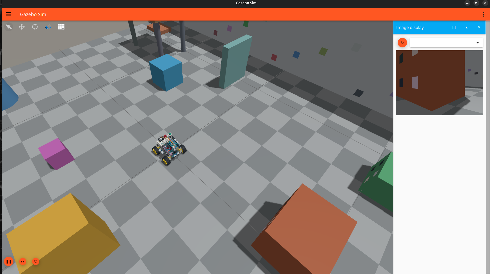
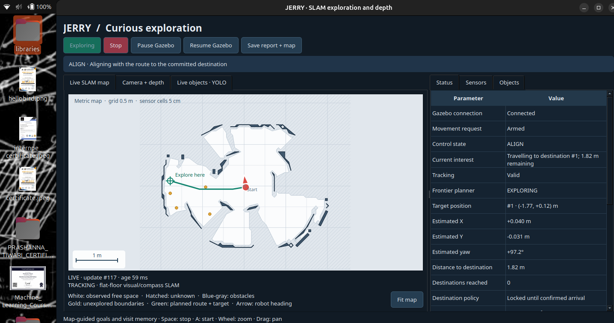
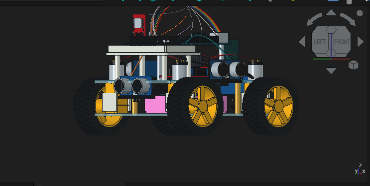
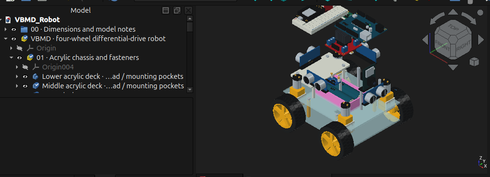
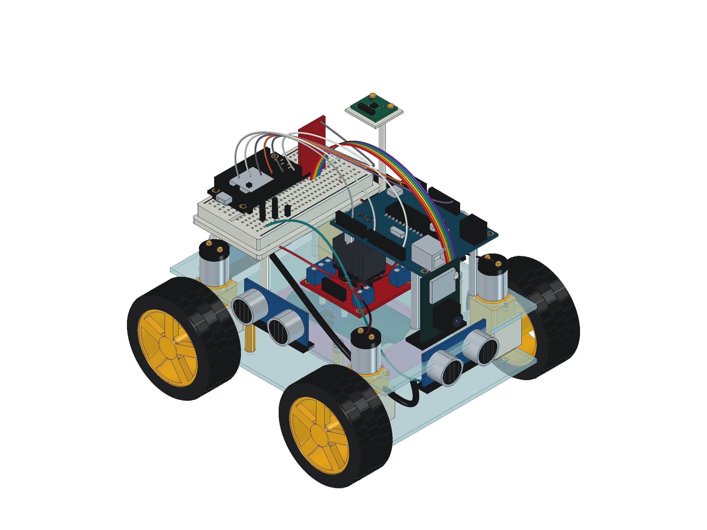
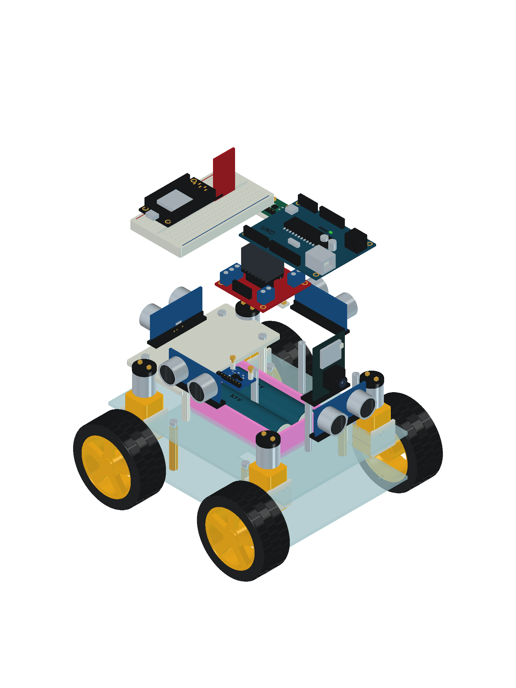

# PROJECT JERRY

**Planning to build a pet robot capable of understanding and learning the environment around it like a lively creature.**

PROJECT JERRY is the full-stack workspace for that robot: ESP32 firmware for the body, Python perception and dialogue software for the brain, a photo-derived FreeCAD model, a Gazebo/ROS 2 simulation of the same machine, and the experimental notebooks that got it started. Everything here is hardware you can buy off the shelf plus code that runs locally — no cloud lock-in, no proprietary SDK.

Right now the "brain" is a laptop or mini-PC sitting on top of a small ESP32-driven chassis. The long-term goal is a companion robot that can see a room, reason about what it sees, navigate toward things, and talk to you about them — an organism, not an appliance.

Complete hardware, firmware, perception, SLAM, exploration and interface details: [JERRY_DESCRIPTION.md](JERRY_DESCRIPTION.md).

---

## Gallery

| | |
|---|---|
|  |  |
| **Fig. 1 — Simulation environment.** The CAD-derived robot in the interactive Gazebo lab: checker floor, colored wall landmarks, fixed obstacles and a movable box, with the live ESP32-CAM image panel on the right. | **Fig. 2 — Live SLAM dashboard.** The JERRY exploration UI: occupancy map with planned route and frontier target, camera/depth and YOLO object tabs, and live status tables (pose estimate, tracking, planner state). |
|  |  |
| **Fig. 3 — Robot design view.** Close-up of the four-wheel differential-drive chassis as modeled for simulation — wheels, ultrasonic modules, decks and wiring. | **Fig. 4 — Design detail.** Further view of the robot model used to validate component layout before hardware changes. |

More CAD renders (isometric, exploded, orthographic and navigation layout) live in [`cad/vbmd_robot/previews/`](cad/vbmd_robot/previews/).

| | |
|---|---|
|  |  |
| **Fig. 5 — Isometric assembly.** Full photo-derived FreeCAD model: transparent decks, gearmotors, L298N driver, breadboard/ESP32 stack, four ultrasonics and the two-cell battery holder. | **Fig. 6 — Exploded view.** Electronics lifted off the chassis to show the stacked deck structure and component placement. |

---

## What's in here

| Directory | What it is |
|---|---|
| `cad/` | Photo-derived FreeCAD assembly of the physical robot (170 × 160 × 140 mm, 60 mm wheels), parametric build scripts, STEP/STL exports, previews and the original reference photographs. See [`cad/vbmd_robot/README.md`](cad/vbmd_robot/README.md). |
| `simulation/` | Gazebo Harmonic + ROS 2 Jazzy package: URDF, 67 CAD-derived meshes, interactive lab world, sensor bridge (camera + four ultrasonics), keyboard/autonomy adapter and launch scripts. Gazebo is the primary simulator. See [`simulation/README.md`](simulation/README.md). |
| `AURA/` | The hybrid multimodal assistant — Whisper STT → LLM intent router → Moondream-2 VLM → Kokoro-82M TTS, with a state-machine orchestrator, memory system and a PySide6 dashboard. This is Jerry's dialogue and perception core. |
| `realtime_depth_app/` | Real-time monocular depth (Depth Anything V2) plus the integrated robot dashboard: live occupancy SLAM, curiosity-driven exploration, YOLO object detection, depth-assisted avoidance and simulator controls. |
| `moondream-live-vqa/` | Live visual question answering against a local Moondream-2 checkpoint — point the camera at something, ask in English, get an answer. No cloud, no token. |
| `esp32-cam-streamer/` | ESP32-CAM firmware + Python receiver that streams live video over WiFi. Jerry's eyes on a $5 board. |
| `esp32-motor-driver/` | ESP32 firmware for dual DC motor control (L298N), driven over UDP with a command failsafe. Jerry's legs. |
| `esp32-hcsr04/` | HC-SR04 ultrasonic ranging firmware for obstacle avoidance. Jerry's whiskers. |
| `esp32-servo/` | Servo control firmware for panning a camera or sensor head. Jerry looking around. |
| `src/` | Shared Python library: robot motion driver (UDP + LLM driving agent), vision helpers, voice TTS glue, Gemini-backed question generation. |
| `notebooks/` | Early depth-estimation experiments — where the project started. |

Each sub-project has its own `README.md`; start there if you want the detail on any one piece.

---

## The stack

**Hardware**

- ESP32-CAM (streaming video)
- ESP32 DevKit + L298N motor driver + DC gear motors (drive base)
- HC-SR04 ultrasonic sensor (proximity) — four-direction ranging in CAD/simulation
- SG90/MG90S servos (sensor head pan/tilt)
- Any USB or network webcam for the high-resolution perception path

**Software**

- **Language models** — Groq-hosted LLMs for intent routing and response composition, with a deterministic local fallback so the robot still works offline
- **Vision** — Moondream-2 running locally for visual question answering; Depth Anything V2 for monocular depth; YOLO for object detection
- **Speech** — faster-whisper for STT, Kokoro-82M for TTS — both local, both real-time
- **Simulation** — Gazebo Harmonic + ROS 2 Jazzy with a CAD-derived robot model and sensor-only interfaces (no fabricated odometry)
- **Mechanical** — parametric FreeCAD model rebuildable from `dimensions.json`
- **Orchestration** — a bounded, observable state machine (`AURA`) that keeps every turn inspectable
- **Interfaces** — PySide6 desktop dashboard (dialogue + robot exploration), interactive CLI, and push-to-talk text entry
- **Firmware** — Arduino/PlatformIO C++ on ESP32, spoken to over UDP

---

## Quick start

### 1. Clone and enter the workspace

```bash
git clone https://github.com/dev-prashanna/PROJECT-JERRY.git
cd PROJECT-JERRY
```

### 2. Run the dialogue brain (AURA)

```bash
cd AURA
pip install -r requirements.txt
cp .env.example .env          # add your GROQ_API_KEY
python3 main.py --demo        # scripted acceptance run
python3 main.py --gui         # desktop dashboard with live camera + depth
```

See `AURA/docs/SETUP.md` for full installation notes, device selection, and troubleshooting.

### 3. Launch the robot simulation (Gazebo + SLAM + exploration)

```bash
simulation/run_robot.sh       # Gazebo, ROS bridge, live depth, SLAM map, autonomous exploration
```

Or start only the simulator: `simulation/run_gazebo.sh` (options: `rviz:=true`, `autonomy:=true`, `headless:=true`). See [`simulation/README.md`](simulation/README.md) for keyboard control, ROS topics and tests.

### 4. Drive the physical robot chassis

```bash
# join the ESP32's soft-AP (192.168.4.1), then:
python3 src/robot/driver.py --manual     # WASD keyboard control
python3 src/robot/driver.py "drive to the wall"   # LLM-driven one-shot
```

### 5. Stream video from the ESP32-CAM

Build and flash `esp32-cam-streamer/` with PlatformIO, then:

```bash
python3 esp32-cam-streamer/stream.py
```

---

## How the pieces talk to each other

```
              ┌──────────────────────────────────────────┐
              │                ESP32 body                │
              │  cam-streamer ─ motor-driver ─ hcsr04    │
              └───────┬──────────────┬───────────┬───────┘
                      │ UDP/video    │ UDP       │ serial
                      ▼              ▼           ▼
   webcam ──►  ┌─────────────────────────────────────────┐
               │              AURA (Python)              │
               │  Whisper ─► intent router ─► Moondream  │
               │      ▲              │            │      │
               │      │              ▼            ▼      │
               │   Kokoro ◄── response gen   depth map   │
               └──────────────────┬──────────────────────┘
                                  │
                                  ▼
                          PySide6 dashboard

   CAD (FreeCAD) ──export──► URDF/meshes ──► Gazebo + ROS 2
                                              │ camera + 4× ultrasonic
                                              ▼
                         realtime_depth_app robot dashboard
                         (SLAM map · depth · YOLO · exploration)
```

A single dialogue turn looks like: hear a question → transcribe it → route the intent → (if visual) grab a camera frame and ask Moondream + depth what's there → compose a spoken reply → say it out loud. Every stage is logged and bounded by timeouts, so a failure in one never hangs the whole loop.

The navigation path is separate: Gazebo publishes hardware-equivalent sensor topics; the dashboard builds an occupancy map, picks frontier goals with visit memory, and drives via `/cmd_vel`. No lidar, no fake `/odom` — sensor-only by design.

---

## Roadmap

- [x] ESP32 motor, servo, ultrasonic and camera firmware
- [x] Local STT / VLM / TTS dialogue loop (AURA)
- [x] Real-time depth perception with distance measurement
- [x] LLM-driven navigation commands to the chassis
- [x] Photo-derived CAD model with parametric rebuild
- [x] Gazebo/ROS 2 simulation with camera + four-direction ranging
- [x] Occupancy SLAM and curiosity-driven exploration dashboard
- [ ] Tight coupling of depth + navigation ("walk to the red chair")
- [ ] On-device learning of room layout and landmarks
- [ ] Long-term memory of people and objects across sessions
- [ ] Emotion / personality layer so Jerry reacts like a creature, not a query engine
- [ ] Fully onboard compute (Jetson or equivalent) so Jerry cuts the laptop loose

---

## Project status

Actively under development. This repository is the complete working tree — firmware, perception, dialogue, CAD, simulation, and the experiments in between. Expect rough edges; the intent is to build in public and keep every subsystem runnable on its own.

## License

Released under the [MIT License](LICENSE). Copyright © 2026 Prashanna Tiwari.

## Author

**Prashanna Tiwari** — [github.com/dev-prashanna](https://github.com/dev-prashanna)
