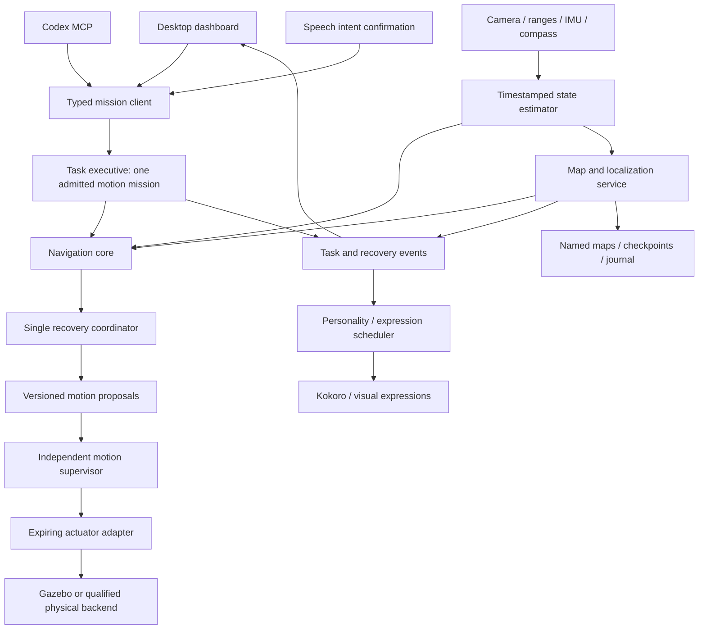
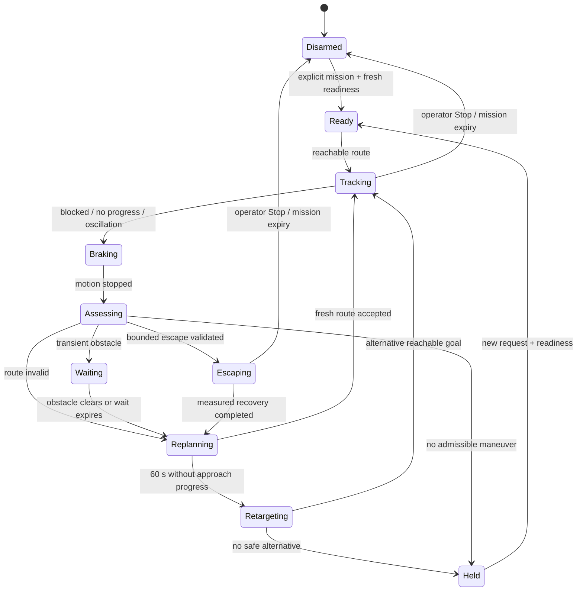

# Jerry: technical implementation roadmap

Date: 7 November 2026. Baseline: commit `de73da3`.

**Status: implementation plan.** This document incorporates the seven requested
improvements. Proposed modules, interfaces and acceptance targets below are not
claims of implemented or validated functionality. Runtime behavior is determined
by the code and advertised capabilities in [JERRY_MCP.md](JERRY_MCP.md).

This roadmap extends [Architecture.md](../Architecture.md). It updates older
requirements that kept destinations indefinitely: active exploration now replaces
a destination after 60 seconds without measurable approach progress. Emergency
stops remain authoritative. A changed destination cannot resolve a collision stop
by itself.

## 1. Outcomes and priority

| Priority | Workstream | Observable outcome | Delivery stage |
|---|---|---|---|
| P0 | One control path | Desktop and MCP admit the same bounded missions through one executive and supervisor | R1 |
| P0 | Coordinated recovery | Jerry escapes recoverable corners without turn conflicts; otherwise reports a specific terminal obstruction | R2 |
| P0 | Footprint-aware clearance | Translation, reversing and turning use calibrated body geometry and speed-dependent stopping envelopes | R2 |
| P0 | Repeatable benchmarks | Every navigation change is compared across fixed worlds, starts, seeds and faults | R0–R3 |
| P1 | Clear dashboard | The operator can see why motion is blocked, the next recovery action and its budget | R1, R4 |
| P1 | Durable map management | Named maps, backups, confidence-aware relocalization and explicit map selection survive restarts | R4 |
| P1 | Trustworthy localization | Pose uncertainty and sensor coverage constrain navigation instead of being hidden | R2, R5 |
| P2 | Destination and object navigation | Click a reachable map point, return to a recorded start, then approach a grounded yellow box | R5, R6 |
| P2 | Personality and emotional expression | Voice and expressions communicate curiosity, discovery and hesitation from real runtime events | R7 |

The first release target is dependable flat-floor simulation exploration. Physical
robot deployment is a later qualification step, not implied by passing Gazebo tests.

## 2. Current implementation and remaining gaps

| Area | Existing implementation | Gap this plan addresses |
|---|---|---|
| Exploration | `realtime_depth_app/src/robot_slam.py`: frontier selection, Dijkstra routes, path following and recovery branches | Recovery decisions interact inside a large module; sparse range cones can disconnect the eroded free-space map |
| Motion protection | `jerry/authority.py`, `supervisor.py`, `adapter.py`: identity, leases, deadlines and collision gates | The legacy desktop controller has a separate command path and different turning limits |
| Missions | `jerry/executive.py`, `navigation.py`: bounded exploration and task results | Coordinate destinations and object search are explicitly gated; recovery and mission progress use different notions of progress |
| Goal timeout | 60 wall-clock seconds without at least 5 cm improvement; unsuccessful area avoided for five minutes | No-destination corner failures need recovery rather than goal replacement; planner status must explain that distinction |
| Maps | `robot_memory.py`: versioned atomic NPZ checkpoints, visual references, scan history and visit counts | One selected file per launch; no map catalog, backup policy, compatibility manifest or operator rollback workflow |
| Mapping capacity | Redundant idle samples suppressed; scan/keyframe capacity surfaced | Long-run compaction and capacity forecasts are still needed |
| Dashboard | SLAM, camera/depth, YOLO, sensors, stall timer and map-memory status | No common protected mission client, recovery timeline, destination picking or map manager |
| Speech | Local Whisper `small.en` through faster-whisper; Kokoro-82M TTS | No coordinated expression scheduler or event-driven personality layer |
| Evidence | 125 targeted tests passed; live corner escape, one arrival, checkpoint reload and a fresh exploration demo were observed | This is not multi-world endurance qualification. Later emergency side stops still required intervention |

Historical results in [the earlier validation report](JERRY_VALIDATION_2026-11-07.md)
refer to that report's source hashes and scenarios. They must not be presented as
qualification of every change in `de73da3`.

## 3. Target architecture and ownership



Ownership rules:

1. The executive owns mission admission, cancellation and total budgets.
2. The exploration planner owns selecting or replacing subgoals.
3. The recovery coordinator owns the current recovery attempt and its transitions.
4. The supervisor independently owns whether a proposal can reach the adapter.
5. The adapter owns final command expiry. Model, GUI or executive stalls cannot
   keep a command alive indefinitely.
6. The map service owns map identity, coordinate revisions and correction barriers.
7. The dashboard, speech and MCP are clients. They do not publish actuator velocity.
8. Personality consumes events and proposes expressions; it has no motion authority.

Use a deterministic state machine first. Nav2's navigation/recovery separation is
a design reference, including its distinct planning and recovery stages;
adopting its complete behavior-tree stack is not required for this refactor.
[Nav2 recovery walkthrough](https://docs.nav2.org/jazzy/getting_started/nav2_behavior_trees/detailed_behavior_tree_walkthrough/detailed_behavior_tree_walkthrough/)

### Proposed source layout

| Module | Responsibility |
|---|---|
| `jerry/navigation_core/state.py` | Immutable sensor, pose, map and readiness snapshots |
| `jerry/navigation_core/progress.py` | Shared goal progress, stationary time and oscillation detection |
| `jerry/navigation_core/recovery.py` | Recovery state machine and attempt budgets |
| `jerry/navigation_core/clearance.py` | Footprint, swept-path and stopping-envelope checks |
| `jerry/navigation_core/exploration.py` | Frontier scoring, failed regions and waypoint selection |
| `jerry/navigation_core/controller.py` | Path tracking and versioned proposal generation |
| `jerry/mission_client.py` | Desktop/MCP-facing typed task client |
| `jerry/map_manager.py` | Map catalog, transactional checkpoints and compatibility checks |
| `jerry/object_grounding.py` | Evidence-linked detections and geometric target hypotheses |
| `jerry/expression.py` | Bounded event-to-expression policy |
| `config/jerry/navigation.yaml` | Versioned navigation, recovery and footprint profile |
| `simulation/benchmarks/` | Scenario definitions, seeded runs and reports |

Extract existing algorithms incrementally; keep compatibility imports while tests
and callers migrate. Avoid simultaneously replacing the planner, estimator and
controller, which would make regressions difficult to attribute.

### Common contracts

Continue using existing `Mission`, `SubmitTask`, `MotionCommand`, `NavigationState`
and `TaskState` interfaces. Extend them additively or introduce versioned messages
where compatibility cannot be maintained. Rebuild the ROS interfaces and all
clients together; JSON dashboard fields alone are not a typed API migration.

New status/event contracts should include:

| Contract | Required fields |
|---|---|
| `NavigationDiagnostics` | session/epoch, map UUID/revision, task/goal IDs, snapshot stamp/receipt age, phase, reason code, blocking sensor, recovery state, elapsed/remaining budget, goal progress and pose quality |
| `RecoveryEvent` | event ID, parent task, goal ID, attempt ID, previous/new state, reason, start/end stamps, measured displacement, selected action and outcome |
| `GoalTransition` | old/new goal, reason (`ARRIVAL`, `STALL_TIMEOUT`, `USER_REQUEST`, `MAP_INVALIDATED`), trusted progress evidence and failed-region expiry |
| `MapDescriptor` | map UUID/name, schema version, coordinate frame, calibration/profile hashes, revision, saved time, coverage estimate and checkpoint health |
| `GroundedTarget` | target ID/label, evidence/frame IDs, map identity, capture time, position/covariance, grounding method, validity limits and ambiguity state |

Use monotonic host time for deadlines and active stall accounting. Sensor time is
for acquisition and synchronization. Persist UTC save times for user-facing map
history; never persist boot-local leases or reuse a previous session's timers.

## 4. Coordinated recovery

Replace independent scan, alignment, reverse and local-escape timers with one
coordinator. A proposal carries the coordinator's attempt ID so a late command
from an old maneuver is rejected after transition or cancellation.



Emergency collision and stale-sensor checks preempt every state. A recoverable
obstruction hold is distinct from the operator Stop latch. Goal replacement does
not clear a Stop latch or grant a fresh lease.

### Decision sequence

1. Brake and obtain a coherent fresh snapshot. Diagnose geometry, sensing,
   localization, mapping capacity, route connectivity and task authority separately.
2. Replan from the measured pose to the existing destination when possible.
3. If needed, score bounded candidates: wait, pivot toward an observed open side,
   reverse within a verified rear corridor, or make a short local clearance step.
4. Reject any candidate whose swept footprint, sensor support, stopping envelope
   or remaining mission budget is insufficient. Recheck while it executes.
5. Execute one candidate at a time. End on measured displacement/heading, time
   expiry, changed geometry, data loss, cancellation or a supervisor veto.
6. Replan and measure whether the attempt improved clearance or goal progress.
   Repeated failed attempts enter a cooldown rather than alternating forever.
7. At 60 seconds without at least 5 cm cumulative improvement toward the goal,
   abandon it and exclude its 35 cm neighborhood for five minutes. Keep these
   baseline values configurable and test their exact boundary behavior.
8. When no goal exists, report `NO_REACHABLE_GOAL`; use bounded mapping/recovery
   attempts rather than a goal timer that can never fire. Exhaustion returns a
   specific held/failed result.

Track best goal distance, net displacement over a rolling window, angular travel,
turn-sign reversals and completed waypoints. Rotation may count as alignment
progress, but never as translational progress for the 60-second destination rule.
Do not treat pose noise, map revision changes or commanded wheel motion as travel.

Initial policy budgets are candidates for simulation tuning, not measured physical
limits: one wait up to 3 s, a pivot up to 1 rad or 4 s, and translation recovery up
to 0.10 m or 4 s. Recovery cycles share the parent mission's distance and time
budget; a new subgoal cannot reset those limits. Recovery stalls while perception
warms up must not consume a maneuver before it can run.

Side-emergency egress is a dedicated future maneuver: enable it only with a tested
directional clearance proof. Until then, a side emergency can legitimately require
repositioning. The benchmark must report that failure rather than reset the world
and count the run as a success.

## 5. Footprint, clearance and sensor consistency

Derive the ground footprint from the URDF/CAD model, including wheels, protruding
sensors and the configured servo envelope. Record calibration uncertainty and a
tested margin. The nominal chassis dimensions alone are not the collision shape.

For each candidate velocity, check the polygon swept through braking, including
reverse and angular motion. Reuse the same geometry and configuration in the
planner, recovery scorer and supervisor; the supervisor still checks proposals
independently. Unify the desktop's historical 0.65 rad/s turns with the protected
profile's 0.4 rad/s cap instead of silently increasing protected limits.

For translation, start with the envelope:

`required_distance = speed_bound × worst_case_latency + speed_bound² / (2 × measured_min_deceleration) + margin`

Measure latency and deceleration for each backend. Use a conservative speed bound
when motion estimates are uncertain. Command integration may predict a swept path;
it must not be published as measured odometry. Angular braking needs a swept-shape
check, not just the translational formula.

Separate slow-down, brake and emergency zones, with hysteresis. Rate-limit normal
commands and make stops immediate. Nav2 documents separate stop, slowdown and
speed-limit collision-monitor zones; use that separation as a reference and
validate Jerry's own sparse-sensor geometry.
[Nav2 collision monitor](https://docs.nav2.org/rolling/configuration_and_development/configuration_guide/core_servers/collision_monitor/configuring_collision_monitor_node/)

The existing 3 cm local corner step is an explicit exception to global unknown-
space clearance, not evidence that the unknown area is free. Keep it isolated,
budgeted and observable while evaluating whether its sensor coverage is adequate.
Do not expand it into arbitrary travel through unknown cells. A proposal rejected
by the protected supervisor remains rejected; recovery must choose another action.

## 6. Benchmarks and release gates

Build the benchmark skeleton before refactoring behavior. Reuse
`simulation/tests/validate_jerry_runtime.py`, the adapter/watchdog tests and the
captured planning/corner NPZ fixtures. Add contact evaluation independent of
navigation; clearance estimates alone cannot prove the robot avoided collisions.

| Scenario family | Required variations |
|---|---|
| Open-room exploration | Multiple starts, headings and frontier layouts |
| Corners and traps | Inside/outside corners, concave pockets, side-near and rear-near starts |
| Corridors | Passable widths relative to the footprint; deliberately impassable widths |
| Dynamic blockage | Crossing object, temporarily blocked route, permanently blocked target |
| Sparse sensing | Gaps between range cones, no echo, noisy returns and conflicting range/depth cues |
| Localization | Low texture, black frames, brief dropout, ambiguous repeated floor and incorrect saved map |
| Lifecycle | Pause/resume, clock reset, application restart, map correction and interrupted checkpoint |
| Authority faults | Delayed/reordered proposals, frozen executive/navigation/supervisor, adapter disconnect and repeated Stop |
| Endurance | Capacity pressure, repeated relocalization, long idle period followed by exploration |

Each run records commit SHA, configuration hash, map/checkpoint identity, scenario,
seed, start pose, duration and hardware/software profile. Save telemetry, goal and
recovery events, contact events and map snapshots. Use ground truth only in the
evaluator; never feed it into navigation or target grounding.

Metrics: independent actual path length; net displacement; frontier arrivals;
reachable-area coverage; longest stationary interval; time in recovery; oscillation
count; interventions; contact count; minimum clearance; stop latency; localization
error; relocalization duration; checkpoint latency; and control/perception timing.
Report missing measurements as unavailable, not zero.

Update the existing evaluator: its current `premature_goal_changes` rule assumes
every unfinished goal switch is wrong. Accept a 60-second switch only when linked
to a valid `STALL_TIMEOUT` event and measured progress history. Preserve checks
against accidental goal churn and false arrival claims.

Initial release targets, to be ratified against the R0 baseline:

| Gate | Target |
|---|---|
| Deterministic regression | All existing relevant tests and added state/geometry/persistence tests pass |
| Scenario matrix | At least 12 scenario configurations × 5 fixed seeds; 5-minute trials for non-fault exploration |
| Contact | Zero detected contacts in the release matrix; unavailable contact measurement blocks this gate |
| Recovery | At least 90% of predefined recoverable traps escaped within 60 active seconds; all others end with an explicit reason |
| Stationary behavior | No silent unexplained stall beyond 60 s; reachable alternatives are selected or inability is reported |
| Stall transition | Goal replacement within 60–62 s of trusted, active non-progress under the tested scheduler load |
| Mapping | At least 80% evaluator-defined reachable free area in 5 minutes for the designated small-room coverage cases |
| Pose quality | Target p95 position error ≤ 0.10 m in the calibrated lab profile; report raw errors without post-hoc alignment |
| Stop | Target zero command within 0.20 s of a local Stop; measure physical settling separately and account for lease/deadline bounds |
| Persistence | 20 close/reopen cycles retain map identity and history; no movement before fresh localization; interrupted save keeps a valid checkpoint |
| Endurance | Three 30-minute runs without unbounded memory growth, silent map freeze or manual world reset |

An aggregate success rate cannot waive a contact, restart-after-Stop or stale-command
failure. Proposed timing targets may require changing current lease/deadline values;
prove those changes with fault tests rather than assuming the defaults meet them.

## 7. Dashboard and mission-client experience

Replace direct arming and velocity ownership with `MissionClient`. Start exploring
admits a bounded executive mission; Stop reaches the independent supervisor and
cancels the task. Show the connected backend, session and map so a viewer cannot
mistake domain 86 data for domain 87 control.

Add these operator features:

- A persistent status banner: current action, blocking reason, next action and
  remaining recovery/mission budget. Distinguish `PAUSED`, `LOCALIZING`, `BLOCKED`,
  `NO_REACHABLE_GOAL`, `MAP_CAPACITY`, `SENSOR_STALE` and `STOPPED_BY_USER`.
- A recovery timeline and goal-change history. Show commanded motion separately
  from measured travel and show unknown measurements explicitly.
- Map overlays for body footprint, projected swept envelope, supported free space,
  unknown space, route, failed goal regions, target uncertainty and sensor age.
- Destination picking after R5 passes: reject occupied, unknown, disconnected,
  outdated-revision or localization-incompatible points before admitting motion.
- Return to the session start or a named saved place. A saved start is not a
  charging dock; docking requires its own perception and hardware contract.
- Map selection, checkpoint health, backup/restore and explicit start-new-map action.
- A benchmark replay view and exportable diagnostic bundle for a failed run.

Keep model inference, checkpoint compression and benchmark export off the Qt event
thread. Test that Stop remains responsive during every background operation.

## 8. Durable maps and localization quality

Keep the current no-pickle, atomic NPZ format as the first storage implementation.
Add a map catalog with immutable UUIDs and a manifest containing schema version,
sensor/extrinsic/calibration hashes, footprint version, floor-model assumptions,
coordinate frame, revision, saved UTC time and data checksums.

Use named rooms and explicit profiles. The active map selection persists across
launches; report-output directories and temporary demo worlds do not implicitly
change it. Simulation world fingerprints help detect mismatches, but physical
rooms still require visual localization evidence.

Checkpoint protocol:

1. Capture a consistent map/pose-graph/visit snapshot at one coordinate revision.
2. Serialize on a background worker to a temporary file; flush and verify it.
3. Atomically update the current checkpoint and manifest; retain the last good
   checkpoint and a bounded backup ring.
4. On interrupted/corrupt save, keep the previous valid version. Report the error
   and its age rather than silently starting a blank map.
5. On normal close, stop motion first and await the final checkpoint within a
   measured shutdown budget. On crash, recover the most recent complete autosave.

Loading restores observations, references and exploration history, never authority,
active tasks or old deadlines. Require a fresh session, compatible calibration,
an unambiguous camera match and a stable localization streak before admitting
motion. If the room/view cannot be recognized, keep the map visible and remain
disarmed or held; expose select-map and start-new-map actions.

Add pose quality based on feature support, temporal consistency, compass health,
residuals and tested uncertainty calibration. Do not label a raw heuristic as a
probability. Limit travel and target grounding when position/yaw uncertainty grows.
Transform or invalidate visit regions, object hypotheses and routes at map
corrections, with the existing supervisor barrier held until the new revision is
coherent.

Plan bounded keyframe/scan compaction that retains localization anchors and graph
constraints. Reaching a storage limit must produce a visible hold; discarding data
must not silently invalidate the saved map.

SLAM Toolbox's serialization and continued-localization workflows are useful
references. It is a separate mapping stack, not a drop-in replacement for Jerry's
camera/compass/four-range estimator; a sensor and TF compatibility study is required
before considering migration.
[SLAM Toolbox documentation](https://index.ros.org/p/slam_toolbox/)

## 9. Destination and object-directed navigation

Implement coordinate navigation first: a validated map point, a collision-checked
route, bounded mission execution, fresh revision checks, and confirmed arrival.
Expose Return to start through the same contract. Keep `navigate` admission gated
until its tests pass; changing an advertised tool name is not implementation.

Then add the yellow-box pipeline:

1. Resolve the requested class/color and detect candidate image regions. Generic
   boxes are not assumed to be a supported pretrained YOLO class; a color/shape
   detector or appropriately evaluated model may be required.
2. Track candidates across timestamped frames, retaining evidence IDs and
   ambiguity. An occluded or ambiguous candidate cannot become a metric goal.
3. Ground position using calibrated geometry. For a verified floor-contact point,
   intersect the camera ray with the calibrated floor plane only when the ray is
   downward, well-conditioned and within the validated floor profile. Otherwise
   use consistent multiple views with trusted poses, or obtain additional evidence.
4. Propagate calibration, pixel and pose uncertainty into the target hypothesis.
   Relative Depth Anything output alone must never supply object distance in metres.
5. Choose an observed-free stand-off pose outside the object's estimated extent
   plus the footprint, stopping envelope and uncertainty margin. Evaluate several
   approach viewpoints rather than planning to the object's center.
6. Navigate through the common executive and supervisor. Reobserve during approach;
   stop/replan when the object moves, identity becomes ambiguous or the map changes.
7. Confirm arrival with fresh target evidence, a satisfied stand-off condition and
   stationary motion. Report `TARGET_LOST`, `AMBIGUOUS`, `UNREACHABLE` or
   `GEOMETRY_UNSUPPORTED` instead of claiming success from a detection alone.

Tests include two yellow objects, lighting changes, a box on a table, hidden floor
contact, reflective surfaces, a moving box, an unreachable object and repeated
floor texture. Ground-truth object positions are evaluator-only labels. Gate
semantic navigation on at least 90% correct approaches in supported cases, zero
contacts, and explicit rejection of all designated unsupported-geometry cases.

Only after coordinate and semantic gates pass should MCP advertise corresponding
tools and speech intents dispatch them. Object text, recalled descriptions and
camera images remain evidence, not operator authorization.

## 10. Personality and emotional expression

Implement an event-driven expressive layer rather than a second motion planner.
Use bounded state variables such as curiosity, confidence and engagement. They
represent behavior/expression state, not a claim that the robot experiences feelings.

| Runtime evidence | Expression | Constraint |
|---|---|---|
| New region observed | Curious animation; occasional short spoken observation | Rate-limited; does not interrupt steering |
| Goal reached | Brief excited expression | Arrival must be confirmed by the mission result |
| Uncertain localization | Hesitant expression and clear explanation | No attempt to override a localization hold |
| Repeated blocked goal | Calm explanation of retry or alternate destination | No repeated speech loop or extra motion attempts |
| Operator Stop | Immediate acknowledgement when audio is available | Motion stops independently of speech generation |

Start with dashboard expressions and Kokoro voice/speed controls that the installed
engine supports. Reuse Whisper for input. Avoid claiming emotion-specific synthesis
capabilities without evaluating them. Deduplicate speech events, give Stop priority,
and place synthesis/playback behind cancellable queues with resource limits.

Personality cannot change clearance thresholds, motion leases, mission budgets or
the definition of success. Expressive body/head movements require their own bounded
actuator task and clearance checks; initially they remain disabled while navigating.

## 11. Delivery sequence, estimates and acceptance

Effort estimates are planning ranges for one engineer familiar with this repository,
not promised dates. Physical hardware work and model-data collection are additional.

| Stage | Deliverables | Dependencies | Exit evidence | Estimate |
|---|---|---|---|---|
| R0: baseline | Reproducible failed corners, seeded runner, contact evaluator, corrected goal-transition metrics | Current code | Baseline artifacts with source/config hashes; failures retained | 2–3 days |
| R1: common control | Typed desktop mission client; dashboard attached to protected runtime; one controller owner; legacy mode visibly isolated | R0 | Same desktop/MCP task semantics, stale-command rejection, Stop/freeze tests | 3–5 days |
| R2: recovery and clearance | Extracted coordinator, shared progress model, footprint/swept-envelope checks and backend-specific configuration | R0, R1 | Unit/replay tests plus corner matrix; no conflicting maneuver owners | 5–8 days |
| R3: qualification | Expanded scenario matrix, nightly runs, performance/contact/coverage reports and release comparison | R2 | Section 6 gates pass or blockers are documented; no hidden resets | 3–5 days |
| R4: map and UX | Named maps, manifest/backups, explicit active profile, confidence/status overlays and diagnostic replay | R1; qualification infrastructure from R3 | Restart/corruption/mismatch tests and responsive GUI | 4–6 days |
| R5: trusted destinations | Pose-quality gates, coordinate navigation, saved start/place navigation and map picking | R2, R4 | Reachable/unreachable destination matrix and verified arrival | 5–8 days |
| R6: object approach | Evidence tracking, floor/multiview grounding, uncertainty-aware stand-off planning, gated tools/intents | R3–R5 | Supported-object approach matrix and rejection tests | 6–10 days |
| R7: expression | Event policy, GUI expressions, cancellable speech and personality profiles | R1, R4; reliable navigation from R3 | No motion-policy influence, truthful event responses, Stop responsiveness | 3–5 days |

Total initial planning range: approximately 31–50 focused engineer-days, or roughly
6–10 working weeks before contingency. Revise estimates after the R0 baseline and
the first extraction. Lightweight expression prototypes may proceed earlier, but
they do not replace the navigation gates.

### Suggested reviewable changes

1. Benchmark scenarios and evidence schema; classify legitimate stalled-goal changes.
2. Add diagnostics and migrate desktop controls to the mission API.
3. Extract pure progress/recovery logic without changing its behavior.
4. Introduce footprint-aware clearance and coordinated candidate selection behind a flag.
5. Qualify recovery with contacts, faults and seeded comparisons; enable by default.
6. Add map manifests, backup/recovery and explicit map profiles.
7. Add coordinate destinations and Return to start after pose-quality gates.
8. Add object grounding, approach validation and gated MCP/speech commands.
9. Add personality/expression scheduling with resource and truthfulness tests.

Every change includes implementation notes, relevant tests, measured behavior,
known limitations and a rollback path. Preserve a replay of each discovered fault.

## 12. Configuration, rollout and migration

Proposed `config/jerry/navigation.yaml` groups:

```yaml
schema_version: 1
profile: gazebo_flat_floor
footprint:
  source: calibrated_urdf
progress:
  goal_timeout_wall_s: 60.0
  improvement_m: 0.05
  failed_goal_radius_m: 0.35
  failed_goal_cooldown_wall_s: 300.0
recovery:
  coordinator_enabled: false  # enable after R2/R3 acceptance
  candidate_translation_limit_m: 0.10
  candidate_wall_limit_s: 4.0
maps:
  autosave_wall_s: 30.0
  require_relocalization: true
  retain_previous_good_checkpoint: true
features:
  coordinate_navigation: false
  object_navigation: false
  expressive_motion: false
```

This is a proposed schema, not a currently supported configuration file. Replace
hard-coded parameters only after the loader validates units, ranges, cross-field
constraints and backend compatibility. Do not change speed/stop limits through an
expression profile or unversioned runtime setting.

Roll out in shadow mode first: record candidate recoveries and supervisor decisions
without actuating them, then use isolated test sessions before default enablement.
Replay old and new policies against identical inputs and compare live seeded runs.
Roll back code and configuration together; never downgrade a map schema in place.

Legacy desktop mode remains available as a diagnostic fallback during migration,
with an unmistakable backend/control-mode label. It cannot share motion ownership
with the protected runtime. The final normal launcher starts one protected runtime
and attaches its viewer; closing the viewer has an explicit, tested mission policy.

## 13. Risks, decisions and physical migration

| Risk / open decision | Required resolution |
|---|---|
| Sparse ranges cannot establish every swept corridor | Report unsupported geometry; benchmark local recovery; evaluate additional sensing only if the current profile cannot meet gates |
| Repeated floor patterns produce false place matches | Ambiguity rejection, temporal confirmation and localization-error evaluation across restarts |
| Recovery thresholds drift between modules | One versioned geometry/profile source plus independent enforcement tests |
| Saved-map write or schema failure | Last-good checkpoint retention, fault injection and explicit operator-visible recovery |
| New goal timeout masks an underlying controller fault | Keep original failure classification and measure interventions/oscillation, not only goal count |
| Models starve control or GUI | Isolated workers, bounded queues, measured latency and dropout/Stop tests under inference load |
| Full Nav2 adoption is assumed to solve sparse sensing | Perform a separate estimator/TF/sensor-contract study; preserve the measured baseline until a replacement qualifies |
| Physical platform differs from the simulator | Measure footprint, braking, clocks, voltage interfaces, communication loss and sensor noise before hardware autonomy |

For physical Jerry, retain a local MCU command timeout and an independently usable
stop path. The proposed UNO R4 WiFi body controller is a future backend, not an
already supported replacement for the ESP32 firmware. Define a validated remote
clock/token protocol; the current same-host monotonic deadline cannot be copied
unchanged onto a microcontroller. Add wheel-encoder or other odometry only when
real measurements and calibration exist, never simulated values labeled as sensors.

## 14. Definition of completion

The roadmap is delivered when the normal dashboard and MCP use the same protected
runtime; recovery passes the declared scenario gates; maps survive restarts and
localize before movement; destination picking and supported object approach produce
verified results; and personality expresses actual events without motion authority.

The operator should be able to answer from the dashboard: where Jerry estimates
it is, how trustworthy that estimate is, what it is attempting, why it stopped,
what it will try next, how long it can try, and which evidence supports success.
Endurance and physical deployment remain separate, explicitly reported qualifications.
